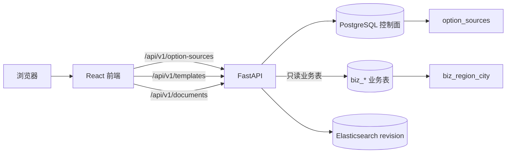
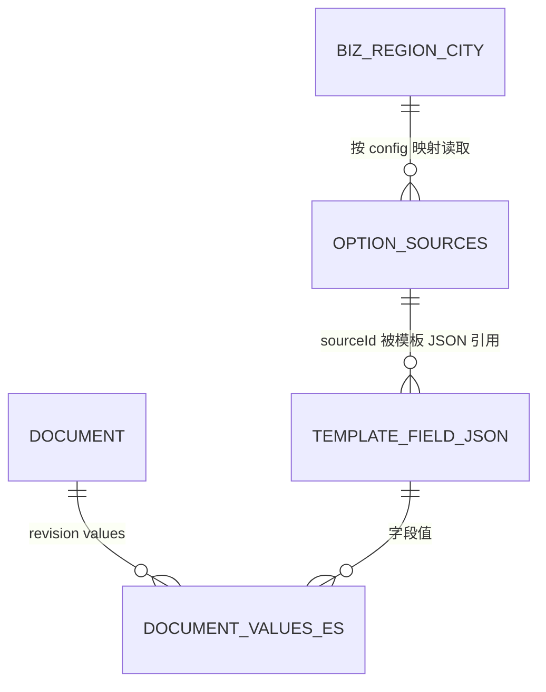
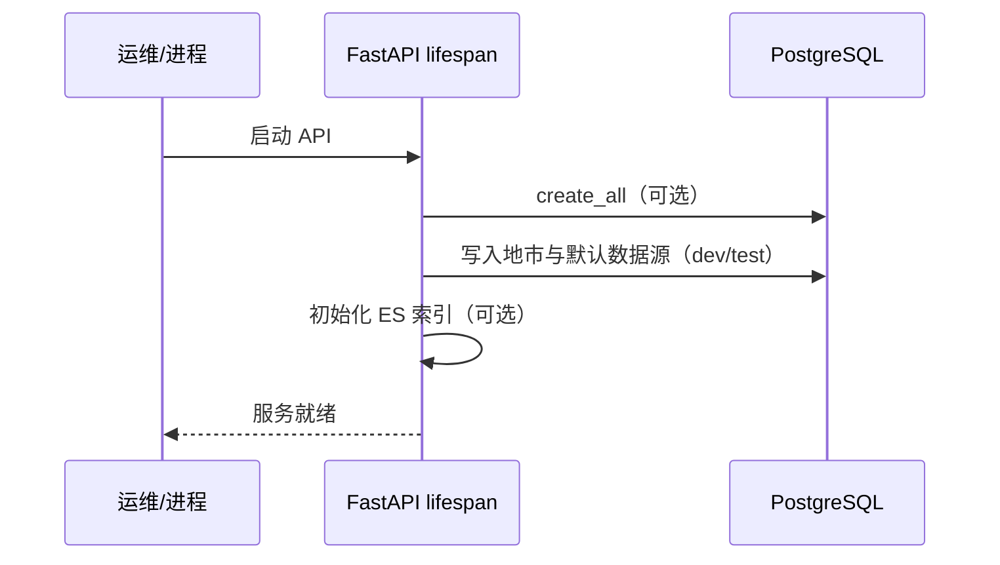
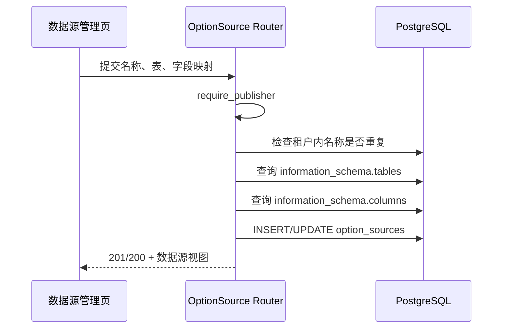
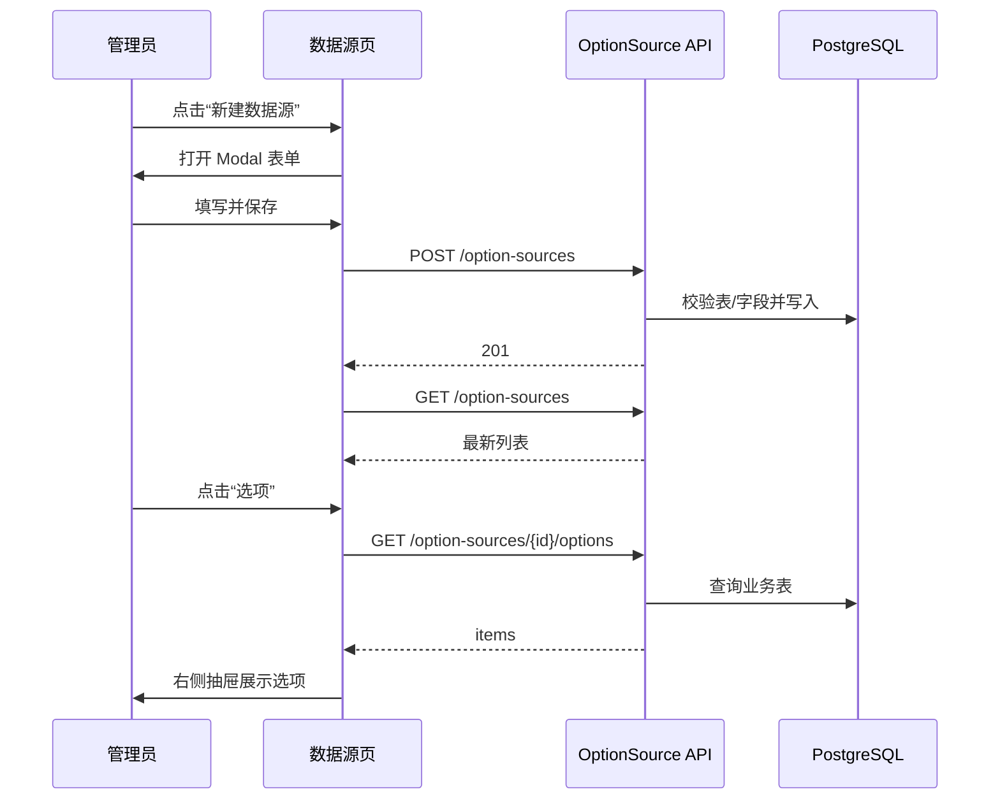
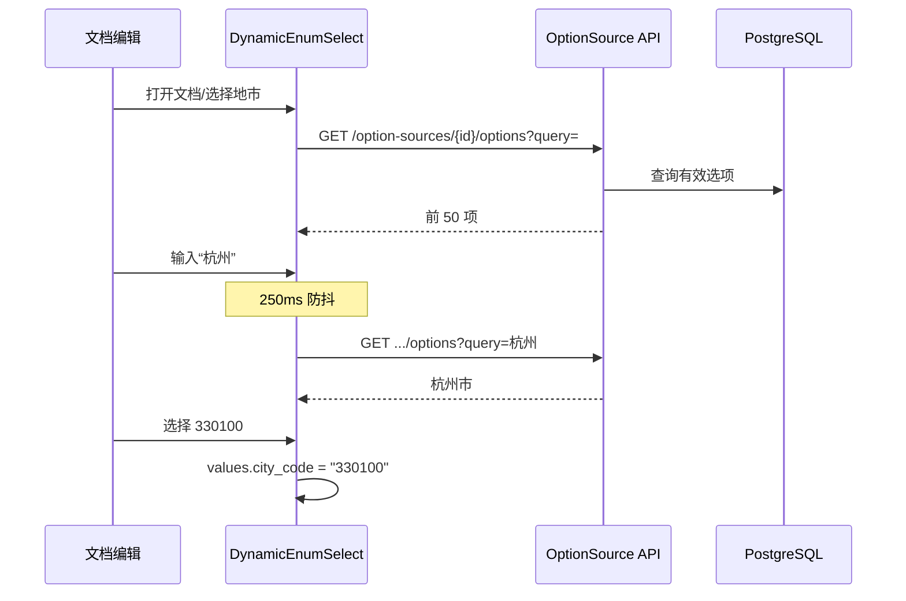
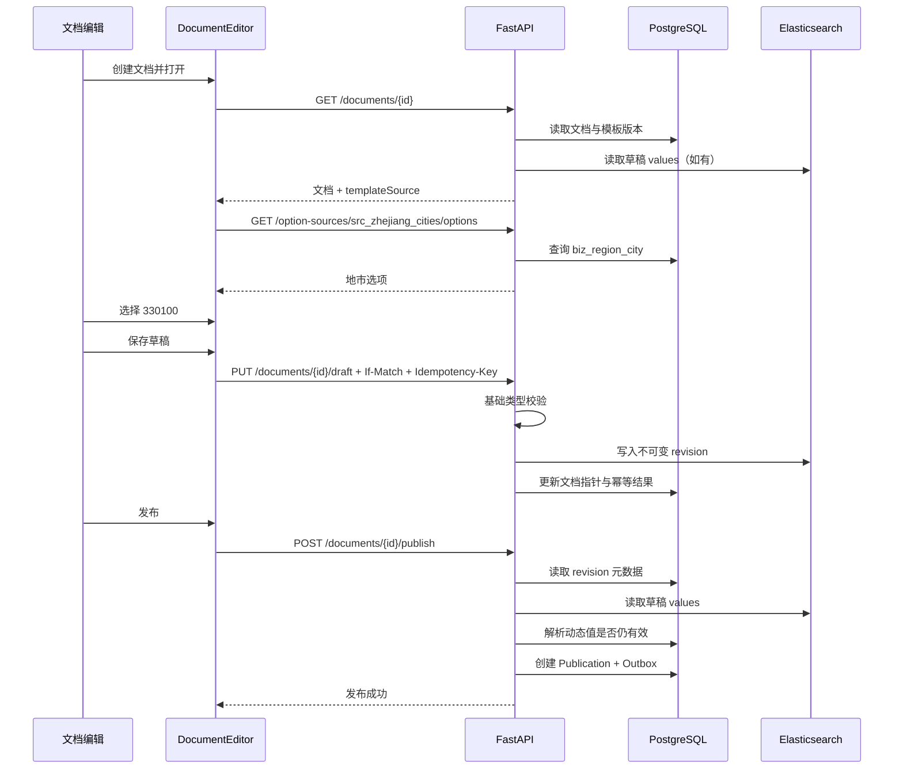

# 动态选项数据源：技术实现与研发培训

> 适用版本：`v0.2.0`  
> 最后更新：2026-10-25  
> 本文以当前代码为准，描述动态选项数据源的原理、数据结构、API、前端交互、端到端流程、测试与扩展方式。规划中的能力会明确标注为“待实现”，不作为现有能力使用。

## 1. 目标与边界

### 1.1 解决的问题

模板中的单选字段有两种取值来源：

1. **固定选项**：选项直接保存在模板里，适合少量、稳定的枚举值。
2. **动态数据源**：模板只保存数据源 ID，文档编辑时从业务表实时读取“值 + 显示名”，适合地市、组织、产品、分类等由业务系统维护的数据。

本次实现以“浙江省地市”为首个样例：

- 业务表：`biz_region_city`
- 值字段：`city_code`，例如 `330100`
- 显示字段：`city_name`，例如 `杭州市`
- 数据源 ID：`src_zhejiang_cities`

### 1.2 已实现能力

- 浙江 11 个地市数据的建表、种子与外部迁移脚本。
- 租户级数据源配置表 `option_sources`。
- 数据源列表、新建、修改、选项查询、已选值解析 API。
- 模板单选字段绑定 `optionsSource.sourceId`。
- 文档编辑时远程搜索、防抖加载、已选值回显。
- 阅读视图将值解析为显示名。
- 发布时重新验证动态值，值失效、源停用或源不存在时拒绝发布。
- “资源 → 数据源”管理页面。

### 1.3 当前不包含的能力

- 跨库、HTTP Provider 或 SQL Provider；当前 Provider 固定为 `postgres_table`。
- 数据源删除 API；当前通过 `enabled=false` 停用。
- 发布时保存显示名快照；已发布文档的显示名仍按源表实时解析。
- 查询缓存、限流、单次查询超时和数据源级 ACL。
- 分页、模糊搜索索引优化、跨 schema 查询。
- 数据库行级安全；租户隔离由应用层完成。

## 2. 架构总览



### 2.1 分层职责

| 层 | 主要文件 | 职责 |
|---|---|---|
| 协议与编译 | `app/compiler.py` | 校验模板字段、编译三阶段 JSON Schema、计算模板哈希、内容基础类型校验 |
| 数据模型 | `app/models.py` | `RegionCity`、`OptionSource` 等 ORM 映射 |
| API 请求模型 | `app/schemas.py` | 数据源配置、创建/修改、批量解析请求的边界校验 |
| 数据源核心 | `app/lookups.py` | 配置校验、白名单标识符、动态 SQL、选项查询、值解析、模板/发布诊断 |
| 数据源 API | `app/routers/option_sources.py` | 数据源管理接口与错误码映射 |
| 模板集成 | `app/routers/templates.py` | 模板创建、草稿保存、校验、导入、发布时检查数据源可用性 |
| 文档集成 | `app/routers/documents.py` | 发布时解析动态值并合并字段级诊断 |
| 初始化 | `app/seed.py`、`migrations/002_option_sources.sql` | 开发/测试种子、外部迁移与浙江地市数据 |
| 前端管理页 | `frontend/src/pages/DataSources.tsx` | 数据源登记、编辑、停用和选项预览 |
| 前端模板编辑 | `frontend/src/pages/TemplateEditor.tsx` | 选择固定选项或系统数据源 |
| 前端文档编辑 | `frontend/src/pages/DocumentEditor.tsx` | 动态单选、远程搜索、已选值解析、阅读标签展示 |

## 3. 核心设计原则

### 3.1 模板不保存表名、列名或 SQL

模板只保存稳定的数据源 ID：

```json
{
  "optionsSource": {
    "sourceId": "src_zhejiang_cities"
  }
}
```

表名、字段映射和 SQL 查询策略保存在 `option_sources.config`。这样业务表结构变化时，只需管理员调整数据源配置，不必批量修改模板。

### 3.2 “值”和“显示名”分离

文档正文只保存稳定的值，例如 `330100`；显示名 `杭州市` 在渲染或阅读时解析。优点是：

- 业务表改名不影响文档中保存的值。
- 下拉框可以显示人类可读名称，不需要把名称写进正文。
- 未来可在发布时增加显示名快照，降低实时解析依赖。

当前没有快照，因此源表名称发生变化后，历史文档的展示名也会随源表变化。

### 3.3 动态单选的 JSON Schema 是普通字符串

编译期无法预知业务表当前的全部选项，因此动态枚举不能生成静态 `enum` 列表，只能生成：

```json
{
  "type": "string",
  "maxLength": 200
}
```

取值是否仍然有效，由发布阶段的 `content_lookup_diagnostics()` 查询数据源决定。这是“编译期结构校验 + 发布期业务校验”的组合。

### 3.4 草稿宽松、发布严格

- 草稿保存：校验基础类型、长度和必填阶段，不要求动态值当前仍存在于业务表。
- 发布：重新读取动态值，检查数据源存在、启用且值仍有效，不通过则返回字段级诊断。

这样可避免业务表短暂不可用或选项调整时阻塞编辑，同时保证最终发布内容可信。

### 3.5 租户隔离

所有数据源读取和写入都带 `tenant_id`：

- 列表只返回当前租户的数据源。
- 新建数据源写入当前身份租户。
- 查询和解析先校验数据源属于当前租户。
- 模板引用数据源时也按当前租户检查。

当前隔离是应用层查询条件，不是 PostgreSQL RLS。生产接入正式身份后，不能直接信任客户端自报租户头。

### 3.6 SQL 安全边界

业务表必须匹配：

```text
^biz_[a-z][a-z0-9_]{0,59}$
```

字段名必须匹配：

```text
^[a-z][a-z0-9_]{0,63}$
```

表名和字段名只是标识符，但会先做正则校验，再用双引号包裹；查询值、搜索词、limit 和批量 IN 参数全部使用参数绑定。模板不能直接提交 SQL。

## 4. 数据结构

### 4.1 浙江省地市业务表 `biz_region_city`

```sql
CREATE TABLE IF NOT EXISTS biz_region_city (
    city_code VARCHAR(12) PRIMARY KEY,
    city_name VARCHAR(80) NOT NULL,
    province_code VARCHAR(12) NOT NULL,
    province_name VARCHAR(40) NOT NULL,
    enabled BOOLEAN NOT NULL DEFAULT TRUE,
    sort_order INTEGER NOT NULL DEFAULT 0,
    updated_at TIMESTAMPTZ NOT NULL DEFAULT NOW()
);
```

字段含义：

| 字段 | 含义 | 在数据源中的角色 |
|---|---|---|
| `city_code` | 地市行政代码 | `valueColumn`，文档保存值 |
| `city_name` | 地市名称 | `labelColumn`，下拉显示名 |
| `province_code` | 省级代码 | 业务归属字段 |
| `province_name` | 省级名称 | 业务归属字段 |
| `enabled` | 是否可供选择 | `activeColumn` |
| `sort_order` | 展示顺序 | `orderBy` |
| `updated_at` | 更新时间 | 运维追踪 |

默认数据：

| city_code | city_name |
|---|---|
| 330100 | 杭州市 |
| 330200 | 宁波市 |
| 330300 | 温州市 |
| 330400 | 嘉兴市 |
| 330500 | 湖州市 |
| 330600 | 绍兴市 |
| 330700 | 金华市 |
| 330800 | 衢州市 |
| 330900 | 舟山市 |
| 331000 | 台州市 |
| 331100 | 丽水市 |

### 4.2 数据源配置表 `option_sources`

```sql
CREATE TABLE IF NOT EXISTS option_sources (
    id VARCHAR(80) PRIMARY KEY,
    tenant_id VARCHAR(80) NOT NULL,
    name VARCHAR(200) NOT NULL,
    description TEXT NOT NULL DEFAULT '',
    provider VARCHAR(40) NOT NULL DEFAULT 'postgres_table',
    config JSONB NOT NULL,
    enabled BOOLEAN NOT NULL DEFAULT TRUE,
    created_by VARCHAR(80) NOT NULL,
    created_at TIMESTAMPTZ NOT NULL DEFAULT NOW(),
    updated_at TIMESTAMPTZ NOT NULL DEFAULT NOW(),
    CONSTRAINT uq_option_source_name UNIQUE (tenant_id, name)
);
```

字段语义：

| 字段 | 说明 |
|---|---|
| `id` | 全局主键，例如 `src_...`；模板保存这个 ID |
| `tenant_id` | 租户隔离键 |
| `name` | 租户内唯一的展示名称 |
| `description` | 管理页说明，最多 500 字符 |
| `provider` | 当前只支持 `postgres_table` |
| `config` | 业务表与字段映射，JSONB |
| `enabled` | 停用后不能被新模板引用，也不能查询/解析/发布 |
| `created_by` | 创建人，用于追踪 |

`config` 结构：

```json
{
  "tableName": "biz_region_city",
  "valueColumn": "city_code",
  "labelColumn": "city_name",
  "searchColumns": ["city_name", "city_code"],
  "activeColumn": "enabled",
  "orderBy": ["sort_order", "city_code"]
}
```

约束与规则：

- `tableName`：最长 64，必须匹配 `biz_*` 规则，必须存在于 `current_schema()`。
- `valueColumn`、`labelColumn`：必填，必须真实存在。
- `searchColumns`：最多 8 个；为空时搜索词不会过滤任何字段。
- `activeColumn`：可空；配置后只返回该字段 `IS TRUE` 的行。
- `orderBy`：最多 8 个；为空时默认按“显示字段、值字段”排序。
- 数据源保存时验证表与字段存在，但不会在每次查询前重新检查表结构。
- 模板版本只固定 `sourceId`，不固定 `option_sources.config` 的快照；修改表/字段映射会影响所有引用该 ID 的模板版本和文档。

### 4.3 模板字段协议

固定选项：

```yaml
fields:
  - id: publish_status
    type: enum
    label: 发布状态
    requiredAt: [publish]
    options:
      - value: draft
        label: 草稿
      - value: published
        label: 已发布
```

动态数据源：

```yaml
fields:
  - id: city_code
    type: enum
    label: 地市
    requiredAt: [publish]
    options: []
    optionsSource:
      sourceId: src_zhejiang_cities
```

规则：

- `optionsSource` 只能用于 `enum` 字段。
- 固定 `options` 与 `optionsSource` 二选一，不能同时配置。
- `sourceId` 长度为 1-80，且对象不允许额外属性。
- 模板哈希包含 `optionsSource`，绑定变化会产生新的模板哈希。
- 只有被布局或索引实际引用的字段进入编译 Schema；孤儿字段不参与内容校验。

当前模板保存时，数据源存在性检查会遍历 `fields` 中所有 `optionsSource`，包括没有被布局引用的字段。因此删除区块后，应同时清理对应字段，避免残留字段引用已停用的数据源。

编译后的字段摘要会保留数据源信息：

```json
{
  "id": "city_code",
  "type": "enum",
  "label": "地市",
  "options": [],
  "optionsSource": {
    "sourceId": "src_zhejiang_cities"
  }
}
```

### 4.4 文档内容值

草稿和发布正文保存在 Elasticsearch 的 revision 文档中，`values` 里保存原始值：

```json
{
  "title": "杭州指南",
  "body": {"type": "doc", "content": []},
  "city_code": "330100"
}
```

PostgreSQL 保存文档、revision 指针、发布记录和幂等操作元数据，不在 PostgreSQL 复制正文。

### 4.5 关系与边界



说明：

- `option_sources` 与业务表之间没有数据库外键，只在保存配置时做存在性与字段校验。
- 模板字段位于 JSON 中，无法对 `optionsSource.sourceId` 建外键；引用完整性由应用层保障。
- 文档值只保存编码，显示名不进入正文。

## 5. 启动、迁移与种子

### 5.1 开发与测试

默认 `DOCCRAFT_AUTO_CREATE_SCHEMA=true`，应用启动时执行 SQLAlchemy `create_all`。之后当 `DOCCRAFT_ENV` 为 `dev` 或 `test` 且 `DOCCRAFT_SEED_DEV_DATA=true` 时：

1. `seed_region_cities()` 幂等写入 11 个浙江地市。
2. `seed_option_sources()` 幂等写入 `src_zhejiang_cities`。
3. 若默认租户还没有模板，再创建并发布默认示例模板。

种子按主键检查是否存在，不覆盖已有业务数据。

### 5.2 外部迁移

生产环境应关闭自动建表，由迁移流程执行：

```text
migrations/001_initial.sql
migrations/002_option_sources.sql
```

`002_option_sources.sql` 在单个事务中创建表、索引、浙江地市数据和默认数据源，并使用 `ON CONFLICT DO NOTHING` 保证重复执行安全。

注意：SQL 迁移中的默认数据源属于 `default` 租户。其他租户需要按自己的租户身份创建对应数据源。

### 5.3 启动顺序



## 6. 后端实现流程

### 6.1 数据源配置保存

入口：`POST /api/v1/option-sources`、`PUT /api/v1/option-sources/{id}`。



校验步骤：

1. 身份必须是发布者类角色。
2. 名称在当前租户内唯一。
3. 表名通过 `biz_` 正则。
4. 所有字段名通过小写标识符正则。
5. 表存在于 `current_schema()`。
6. 值字段、显示字段、搜索字段、启用字段、排序字段均存在。
7. 保存规范化后的 config。

当前没有 `DELETE`。停用数据源时，将 `enabled` 设为 `false`。

### 6.2 选项查询

入口：`GET /api/v1/option-sources/{id}/options`。

逻辑：

1. 读取数据源并校验租户、启用状态和 Provider。
2. 校验搜索词最长 100，limit 限制为 1-100。
3. 配置了 `activeColumn` 时追加 `"activeColumn" IS TRUE`。
4. 配置了搜索字段时，对所有搜索字段做 `LOWER(CAST(column AS TEXT)) LIKE :query` 的 OR 查询。
5. 按 `orderBy` 排序，最多返回 limit 条。
6. 值和显示名都转为字符串。

核心 SQL 形态：

```sql
SELECT CAST("city_code" AS TEXT) AS value,
       CAST("city_name" AS TEXT) AS label
FROM "biz_region_city"
WHERE "enabled" IS TRUE
  AND (LOWER(CAST("city_name" AS TEXT)) LIKE :query
       OR LOWER(CAST("city_code" AS TEXT)) LIKE :query)
ORDER BY "sort_order", "city_code"
LIMIT :limit;
```

表名和列名来自配置，但已经过正则校验和双引号包裹；查询词和 limit 是绑定参数。

### 6.3 已选值解析

入口：`POST /api/v1/option-sources/{id}/resolve`。

用途：

- 文档编辑器回显不在首屏的已选值。
- 阅读视图批量获取显示名。
- 发布时检查值是否仍存在且有效。

逻辑：

1. 去重并过滤空值。
2. 保留 `activeColumn IS TRUE` 条件。
3. 使用展开参数执行 `CAST(valueColumn AS TEXT) IN :values`。
4. 返回 `{value: label}` 映射；接口层输出 `items` 和 `missing`。

### 6.4 模板与数据源的集成点

`ensure_option_sources()` 在以下接口执行：

| 接口 | 行为 |
|---|---|
| `POST /templates` | 保存前检查引用的数据源存在且启用 |
| `PUT /templates/{id}/draft` | 保存前检查 |
| `POST /templates/{id}/validate` | 校验前检查 |
| `POST /templates/{id}/publish` | 发布新模板版本前检查 |
| `POST /templates/import/yaml` | 导入前检查 |

检查当前只看数据源存在性、租户归属和启用状态。普通选项查询与解析接口还会检查 Provider 类型；发布诊断依赖数据源通过管理 API 写入时固定为 `postgres_table`。

错误返回示例：

```json
{
  "code": "TEMPLATE_INVALID",
  "message": "模板引用的数据源不可用",
  "diagnostics": [
    {
      "path": "fields.city_code.optionsSource",
      "message": "数据源已停用"
    }
  ],
  "traceId": "..."
}
```

### 6.5 编译结果

`app/compiler.py` 的关键行为：

- `compilerVersion`：`1.1`。
- 静态枚举：生成 `{"type":"string","enum":[...]}`。
- 动态枚举：生成 `{"type":"string","maxLength":200}`，不带 `enum`。
- `source`：规范化后的完整模板，保留 `optionsSource`。
- `templateHash`：对规范化模板计算 SHA-256。
- `ui` / `view`：包含字段摘要和 `optionsSource`，供前端/预览使用。
- 三阶段 Schema：`draft`、`submit`、`publish` 的 required 不同。

### 6.6 文档草稿保存

`PUT /api/v1/documents/{id}/draft`：

1. 校验 `If-Match` 和 `Idempotency-Key`。
2. 锁定文档行并检查控制版本。
3. 加载文档绑定的不可变模板版本。
4. 执行 `validate_content(..., "draft")`。
5. 动态枚举只做字符串和长度校验。
6. 写入只追加的 ES revision，更新 PG 指针、版本号和幂等结果。

因此，业务表临时不可用时，已经填写过的动态值仍可保存草稿。

### 6.7 文档发布

`POST /api/v1/documents/{id}/publish`：

1. 锁定文档并读取草稿 revision。
2. 加载该文档固定的模板版本。
3. 执行基础发布校验：类型、必填、媒体状态。
4. 执行 `content_lookup_diagnostics()`：
   - 只检查布局或索引中仍在使用的字段；
   - 按数据源分组，减少查询次数；
   - 检查数据源存在、启用、可查询；
   - 检查值仍在有效选项集合中。
5. 有任何诊断则返回 422，不创建发布记录。
6. 通过后创建 Publication 和 Outbox 事件，更新发布指针。

## 7. API 约定

### 7.1 通用约定

- Base URL：`/api/v1`
- 内容类型：`application/json`
- 开发身份头：
  - `X-DocCraft-Tenant`
  - `X-DocCraft-User`
  - `X-DocCraft-Role`
- 错误结构通常包含：`code`、`message`、`traceId`；校验类错误可能包含 `diagnostics`。
- 写操作要求发布者类角色：`publisher`、`template_admin`、`kb_admin`、`tenant_admin`。

### 7.2 接口总览

| 方法 | 路径 | 权限 | 用途 |
|---|---|---|---|
| `GET` | `/option-sources` | 任意有效身份 | 列出当前租户全部数据源，包含停用项 |
| `POST` | `/option-sources` | 发布者类角色 | 新建数据源 |
| `PUT` | `/option-sources/{id}` | 发布者类角色 | 修改名称、说明、配置、启用状态 |
| `GET` | `/option-sources/{id}/options` | 任意有效身份 | 远程搜索/读取选项 |
| `POST` | `/option-sources/{id}/resolve` | 任意有效身份 | 批量解析已选值 |

### 7.3 列出数据源

```http
GET /api/v1/option-sources
```

响应：

```json
{
  "items": [
    {
      "id": "src_zhejiang_cities",
      "name": "浙江省地市",
      "description": "从 biz_region_city 业务表动态读取浙江省地市代码和名称",
      "provider": "postgres_table",
      "enabled": true,
      "tableName": "biz_region_city",
      "valueColumn": "city_code",
      "labelColumn": "city_name",
      "searchColumns": ["city_name", "city_code"],
      "activeColumn": "enabled",
      "orderBy": ["sort_order", "city_code"],
      "createdAt": "2026-10-25T07:40:00Z",
      "updatedAt": "2026-10-25T07:40:00Z"
    }
  ]
}
```

### 7.4 新建数据源

```http
POST /api/v1/option-sources
Content-Type: application/json
```

```json
{
  "name": "浙江省地市",
  "description": "浙江地市字典",
  "enabled": true,
  "tableName": "biz_region_city",
  "valueColumn": "city_code",
  "labelColumn": "city_name",
  "searchColumns": ["city_name", "city_code"],
  "activeColumn": "enabled",
  "orderBy": ["sort_order", "city_code"]
}
```

成功：`201 Created`，返回数据源视图。

错误：

| HTTP | code | 场景 |
|---|---|---|
| 403 | `FORBIDDEN` | 当前角色无写权限 |
| 409 | `OPTION_SOURCE_EXISTS` | 当前租户名称重复 |
| 422 | `OPTION_SOURCE_INVALID` | 表/字段不存在或名称不合法 |

### 7.5 修改或停用数据源

```http
PUT /api/v1/option-sources/{source_id}
```

请求体与新建相同。当前 `PUT` 是整体更新，不是部分更新。

停用请求示例：

```json
{
  "name": "浙江省地市",
  "description": "暂停使用",
  "enabled": false,
  "tableName": "biz_region_city",
  "valueColumn": "city_code",
  "labelColumn": "city_name",
  "searchColumns": ["city_name", "city_code"],
  "activeColumn": "enabled",
  "orderBy": ["sort_order", "city_code"]
}
```

成功：`200 OK`。不存在或跨租户：`404 NOT_FOUND`。名称冲突：`409 OPTION_SOURCE_EXISTS`。

### 7.6 查询选项

```http
GET /api/v1/option-sources/src_zhejiang_cities/options?query=杭州&limit=50
```

参数：

| 参数 | 类型 | 默认 | 约束 |
|---|---|---|---|
| `query` | string | 空 | 最长 100 |
| `limit` | integer | 50 | 1-100 |

响应：

```json
{
  "items": [
    {"value": "330100", "label": "杭州市"}
  ]
}
```

错误：

| HTTP | code | 场景 |
|---|---|---|
| 422 | `OPTION_SOURCE_UNAVAILABLE` | 数据源不存在、已停用、配置无效、Provider 不支持 |
| 503 | `OPTION_SOURCE_UNAVAILABLE` | 业务表查询失败 |

### 7.7 解析已选值

```http
POST /api/v1/option-sources/src_zhejiang_cities/resolve
Content-Type: application/json
```

```json
{
  "values": ["330100", "999999"]
}
```

响应：

```json
{
  "items": [
    {"value": "330100", "label": "杭州市"}
  ],
  "missing": ["999999"]
}
```

规则：最多 200 个值；输入去重；只返回当前启用且存在的选项。

### 7.8 相关模板与文档 API

数据源本身通过上述接口管理，模板和文档接口继续使用原有协议：

| 方法 | 路径 | 动态数据源相关行为 |
|---|---|---|
| `GET` | `/templates/{id}` | 返回模板源和编译结果，其中包含 `optionsSource` |
| `PUT` | `/templates/{id}/draft` | 保存前检查数据源可用，需要 `If-Match` |
| `POST` | `/templates/{id}/validate` | 校验模板并检查数据源 |
| `POST` | `/templates/{id}/publish` | 校验后生成不可变模板版本 |
| `POST` | `/templates/import/yaml` | 导入 YAML 前检查数据源 |
| `GET` | `/documents/{id}` | 返回文档值、固定模板版本和源 |
| `PUT` | `/documents/{id}/draft` | 草稿只做基础类型校验 |
| `POST` | `/documents/{id}/publish` | 动态值必须仍有效 |
| `GET` | `/documents/{id}/published` | 返回发布正文和模板源，前端负责解析显示名 |

### 7.9 完整 curl 示例

```bash
BASE=http://127.0.0.1:8100/api/v1

curl -sS "$BASE/option-sources" \
  -H 'X-DocCraft-Tenant: default' \
  -H 'X-DocCraft-User: dev-user' \
  -H 'X-DocCraft-Role: publisher'

curl -sS "$BASE/option-sources/src_zhejiang_cities/options?query=杭州&limit=50" \
  -H 'X-DocCraft-Tenant: default' \
  -H 'X-DocCraft-User: dev-user' \
  -H 'X-DocCraft-Role: publisher'

curl -sS -X POST "$BASE/option-sources/src_zhejiang_cities/resolve" \
  -H 'Content-Type: application/json' \
  -H 'X-DocCraft-Tenant: default' \
  -H 'X-DocCraft-User: dev-user' \
  -H 'X-DocCraft-Role: publisher' \
  -d '{"values":["330100"]}'
```

## 8. 前端实现

### 8.1 路由与入口

- 路由：`/#/data-sources`
- 侧栏：`资源 → 数据源`
- API 封装：`frontend/src/api.ts`
- 类型：`frontend/src/types.ts`

### 8.2 数据源管理页

`DataSourcesPage` 支持：

- 加载当前租户数据源表格。
- 新建：名称、说明、业务表、值字段、显示字段、搜索字段、启用字段、排序字段、启用开关。
- 编辑：回填现有配置并整体提交。
- 选项预览：调用 `optionItems(id, "", 20)`，在右侧抽屉显示前 20 项。
- 错误反馈：列表加载失败显示重试；保存或预览失败通过消息提示。

交互链路：



### 8.3 模板编辑器

字段类型切换为 `单选` 后，字段编辑抽屉显示“选项来源”分段控件：

- `固定选项`：原有多行文本，每行 `值|显示名`。
- `系统数据源`：下拉选择已登记的数据源；停用源显示“已停用”且不可选。

选择“系统数据源”时：

1. 清空静态 `options`。
2. 写入 `optionsSource.sourceId`。
3. 页面加载时调用 `GET /option-sources`，只允许选择启用的数据源。

切换到固定选项时清空 `optionsSource`，并至少保留一个固定选项，满足编译器约束。

### 8.4 文档编辑器动态单选

`DynamicEnumSelect` 行为：

1. 首次渲染按 `sourceId` 拉取前 50 项。
2. 用户输入搜索词后，250ms 防抖，再调用选项查询接口。
3. `filterOption={false}`，搜索由服务端完成，不在浏览器本地过滤。
4. 当前选中值如果不在当前结果里，调用 `resolve` 单独补入，保证编辑/回显时显示名称。
5. 加载失败显示错误状态和错误文本；无匹配显示“无匹配选项”。
6. 清空下拉框时写入空字符串。



### 8.5 阅读视图显示名解析

发布阅读接口返回正文和模板源。前端 `resolveLookupLabels()`：

1. 遍历模板字段，找出有 `optionsSource` 且有字符串值的字段。
2. 按 `sourceId` 分组，每个数据源只调用一次 `resolve`。
3. 建立 `fieldId -> label` 映射。
4. 阅读组件优先显示 label，否则回退到原始值。

如果解析失败，当前前端会静默回退到原始编码，例如显示 `330100`。这保证阅读不因数据源临时不可用而完全失败，但也是现有体验的一个限制。

## 9. 端到端流程

### 9.1 角色与状态


### 9.2 初始化流程

1. 数据库执行迁移或 ORM 建表。
2. `biz_region_city` 写入浙江 11 个地市。
3. `option_sources` 写入 `src_zhejiang_cities`。
4. API 启动并注册 `/option-sources` 路由。
5. 前端打开“数据源”页面，看到默认数据源。

### 9.3 数据源管理与预览

1. 管理员进入“资源 → 数据源”。
2. 系统调用 `GET /option-sources`。
3. 点击“选项”调用 `GET /option-sources/{id}/options`。
4. PostgreSQL 按 `enabled=true`、排序字段返回选项。
5. 抽屉展示选项值/显示名。

### 9.4 模板绑定流程

1. 打开模板编辑器。
2. 选择字段，切换为“单选”。
3. 选择“系统数据源”和“浙江省地市”。
4. 前端把字段改为 `optionsSource`，清空静态 `options`。
5. 保存模板调用 `PUT /templates/{id}/draft`，携带 `If-Match`。
6. 后端编译模板，检查字段约束和数据源可用性。
7. 发布模板后生成不可变 `TemplateVersion`，文档后续绑定该版本。

### 9.5 文档编辑、保存、发布



### 9.6 有效与无效值

有效值：

```json
{"city_code": "330100"}
```

发布成功，阅读时解析为“杭州市”。

无效值：

```json
{"city_code": "999999"}
```

草稿可以保存，但发布返回：

```json
{
  "code": "CONTENT_INVALID",
  "message": "内容不满足发布要求",
  "diagnostics": [
    {
      "path": "city_code",
      "message": "选项已失效或不属于该数据源"
    }
  ]
}
```

### 9.7 数据源停用或选项删除

| 阶段 | 结果 |
|---|---|
| 模板保存 | 引用停用源会返回 `TEMPLATE_INVALID` |
| 文档草稿 | 仍可保存已有值，不做动态有效性校验 |
| 文档发布 | 数据源停用或值不存在会返回 `CONTENT_INVALID` |
| 已发布阅读 | 前端解析失败时回退显示原始值 |

### 9.8 关键失败场景

| 场景 | 表现 | 处理 |
|---|---|---|
| 表不存在 | 创建数据源 422 | 检查表名、schema、迁移 |
| 字段不存在 | 创建数据源 422 | 检查配置中的列名 |
| 数据源停用 | 查询/解析 422；模板保存 422 | 重新启用或修改模板 |
| 查询 SQL 失败 | 选项接口 503 | 检查业务表结构、数据库连接、权限 |
| 搜索词无匹配 | `items=[]` | 正常空结果 |
| 值不在源中 | 草稿可存，发布 422 | 重新选择有效值 |
| 源表名称变更 | 历史阅读显示名可能变化 | 引入 label 快照 |
| 源表临时不可用 | 草稿可存，发布失败 | 恢复业务表后重试 |

## 10. 测试与验收

### 10.1 自动化测试

编译与协议测试：

```bash
python3 -m pytest -q tests/test_compiler.py
```

覆盖：

- 动态单选生成普通字符串 Schema。
- 动态单选不能与静态 `options` 混用。
- 有效动态值通过内容校验。

PostgreSQL 集成测试：

```bash
DOCCRAFT_INTEGRATION=1 \
PYTHONPATH=/path/to/PyUploadX/sdk \
python3 -m pytest -q tests/test_api_integration.py
```

覆盖：

- 浙江地市查询。
- 数据源列表、创建、停用。
- 模板绑定动态数据源。
- 有效值保存并发布。
- 无效值发布被拒绝。

前端构建与 E2E：

```bash
cd frontend
npm run build
DOCCRAFT_WEB_URL=http://127.0.0.1:8100 npx playwright test
```

相关 E2E：

- “数据源管理显示浙江地市动态选项”
- “模板单选可以绑定系统数据源”

### 10.2 手工验收清单

- [ ] 数据源列表能看到“浙江省地市”。
- [ ] 选项预览包含杭州市和丽水市。
- [ ] 搜索“杭州”只返回 `330100 / 杭州市`。
- [ ] 模板字段可以切换固定选项/系统数据源。
- [ ] 模板保存时选择停用数据源会被拒绝。
- [ ] 文档动态下拉支持远程搜索。
- [ ] 已选值不在当前搜索结果时仍能显示名称。
- [ ] 有效值可以发布。
- [ ] 无效值发布返回字段级错误。
- [ ] 阅读视图显示“杭州市”而不是 `330100`。

## 11. 运维与新增数据源

### 11.1 新增一个下拉数据源

1. 在 PostgreSQL 创建业务表，表名以 `biz_` 开头。
2. 确认有稳定的值字段、显示字段、启用字段和排序字段。
3. 进入“资源 → 数据源”，新建并填写映射。
4. 在“选项”抽屉中预览结果。
5. 在模板中把单选字段切换为“系统数据源”。
6. 保存、校验并发布模板。
7. 创建测试文档，验证保存、发布和阅读。

### 11.2 业务表设计建议

- 值字段使用稳定编码，不使用可能变化的名称。
- 值字段最好唯一；当前查询只读取，不强制唯一，重复值会返回多条。
- 显示字段不应为空。
- 提供可用于搜索的名称字段。
- 提供布尔启用字段，避免删除历史数据。
- 提供确定性排序字段。
- 业务表推荐加索引，至少覆盖启用字段和常用排序；当前搜索使用 `%...%`，普通 B-tree 无法完全优化。

### 11.3 排障命令

```sql
-- 检查表与字段
SELECT column_name, data_type
FROM information_schema.columns
WHERE table_schema = current_schema()
  AND table_name = 'biz_region_city'
ORDER BY ordinal_position;

-- 检查数据源配置
SELECT id, tenant_id, name, provider, enabled, config
FROM option_sources
WHERE id = 'src_zhejiang_cities';

-- 检查有效地市
SELECT city_code, city_name
FROM biz_region_city
WHERE enabled IS TRUE
ORDER BY sort_order, city_code;
```

常见问题：

| 现象 | 排查方向 |
|---|---|
| 创建时提示业务表不存在 | 是否在 `current_schema()`；迁移是否执行 |
| 创建时提示缺少字段 | 列名大小写、拼写、schema 是否一致 |
| 选项为空 | `enabled` 条件是否全部为 false；显示字段是否为空 |
| 搜索无结果 | `searchColumns` 是否配置；字段是否包含目标文本 |
| 发布提示选项失效 | 值是否被删除或 `enabled=false` |
| 阅读显示编码 | 数据源停用、解析失败或字段未绑定 `optionsSource` |

## 12. 性能、安全与已知限制

| 主题 | 当前实现 | 风险/后续 |
|---|---|---|
| 查询次数 | 每次搜索/解析实时查询业务表 | 高频表单需缓存或限流 |
| 搜索 | `LOWER(CAST(...)) LIKE '%q%'` | 大表全表扫描；可增加专用搜索列或 Provider |
| 分页 | 只有 limit，没有 offset/cursor | 大数据集需分页 |
| 超时 | 依赖数据库连接/请求超时 | 应增加数据源级 statement timeout |
| 租户 | 应用层 `tenant_id` 过滤 | 无 RLS；正式身份需可信租户上下文 |
| 权限 | 管理写操作要求发布者角色 | 无数据源级 ACL |
| 一致性 | 模板只存 sourceId；读取实时解析 | 无 label 快照，历史展示可能变化 |
| 可用性 | 源表不可用会阻止发布 | 可增加快照/降级策略 |
| Provider | 只有 `postgres_table` | 后续可抽象 Provider 接口 |
| 配置并发 | `PUT` 没有 ETag/CAS，后写覆盖先写 | 管理端并发编辑需增加版本控制 |
| 删除 | 只支持停用 | 需评估引用检查后再提供删除 |

## 13. 后续迭代建议

1. **发布 label 快照**：在 Document 或 Publication 中保存动态字段的显示名快照，避免源表改名影响历史阅读。
2. **Provider 抽象**：定义统一接口，支持 HTTP、外部数据库、Elasticsearch 或服务目录。
3. **缓存与限流**：按 `sourceId + query` 缓存短 TTL；增加每租户 QPS、最大结果数和超时。
4. **数据源级权限**：区分只读、管理、发布引用权限，记录变更审计。
5. **删除与引用保护**：删除前检查模板和已发布文档引用。
6. **分页与索引优化**：为大数据源增加 cursor/offset、前缀搜索或专门搜索字段。
7. **模板残留清理**：只校验 active fields，或在删除区块时清理孤儿字段引用。
8. **管理端诊断**：在数据源页展示最近查询错误、耗时和样本数据。

## 14. 推荐代码阅读顺序

1. `migrations/002_option_sources.sql`：先看表和种子数据。
2. `app/models.py`：确认 ORM 字段和约束。
3. `app/schemas.py`：确认 API 输入边界。
4. `app/lookups.py`：理解配置校验、SQL 生成、查询和解析。
5. `app/routers/option_sources.py`：理解 API 与错误映射。
6. `app/compiler.py`：理解 `enum`、`optionsSource` 和 JSON Schema。
7. `app/routers/templates.py`：理解模板保存/发布时的数据源检查。
8. `app/routers/documents.py`：理解草稿与发布的校验差异。
9. `frontend/src/pages/DataSources.tsx`：管理端交互。
10. `frontend/src/pages/TemplateEditor.tsx`：字段绑定交互。
11. `frontend/src/pages/DocumentEditor.tsx`：远程搜索、回显和阅读标签。
12. `tests/test_compiler.py`、`tests/test_api_integration.py`、`frontend/e2e/smoke.spec.ts`：用测试确认边界。
