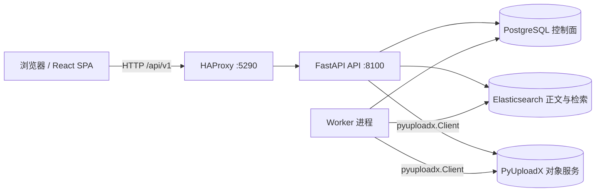
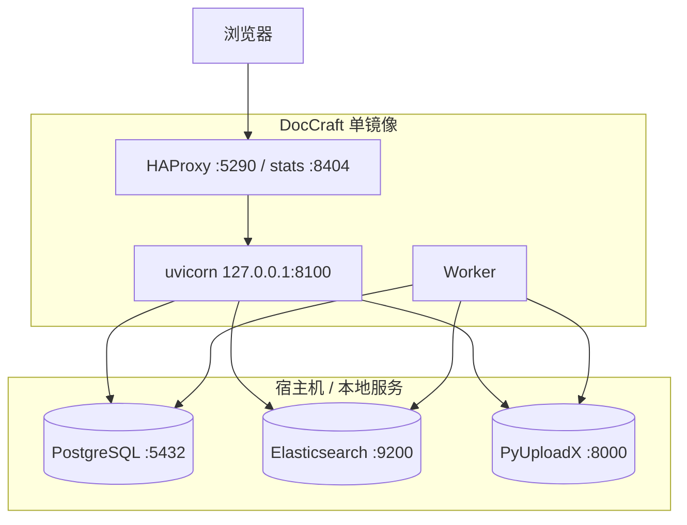
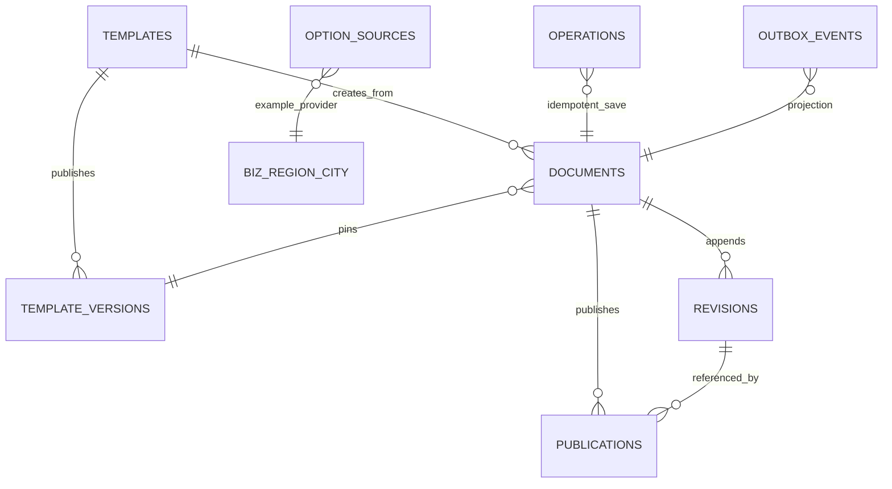
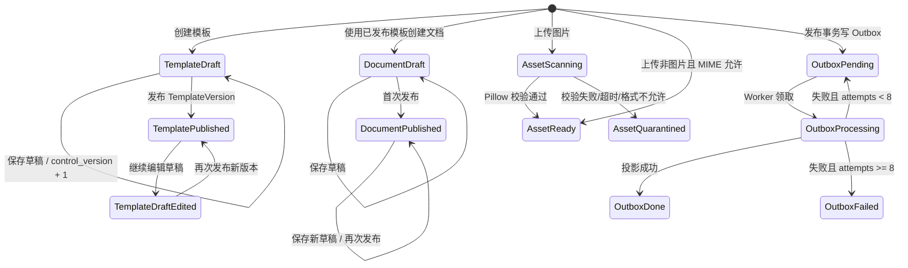
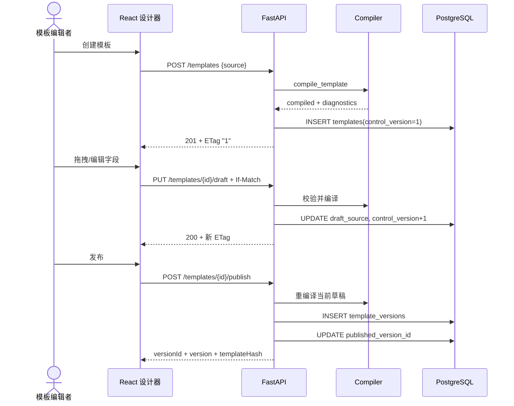
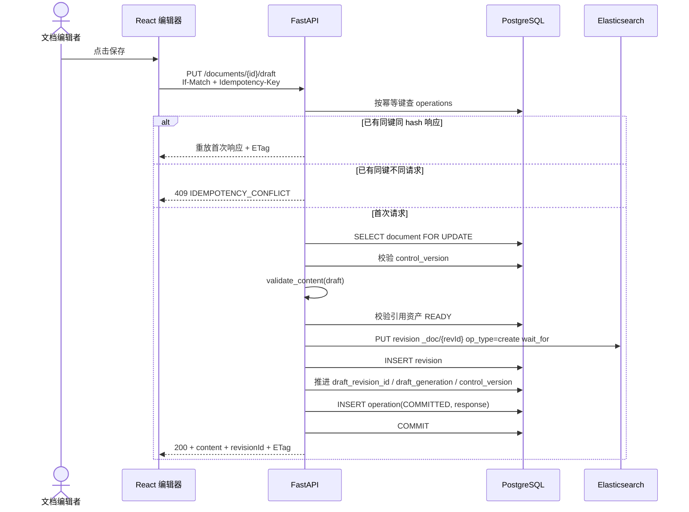
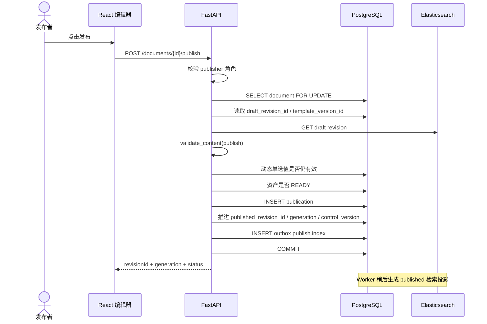
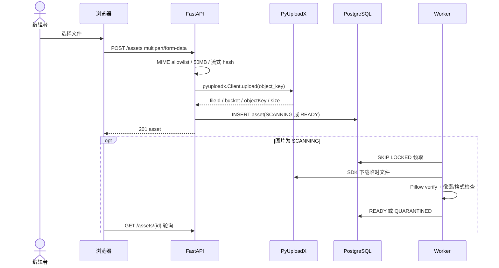
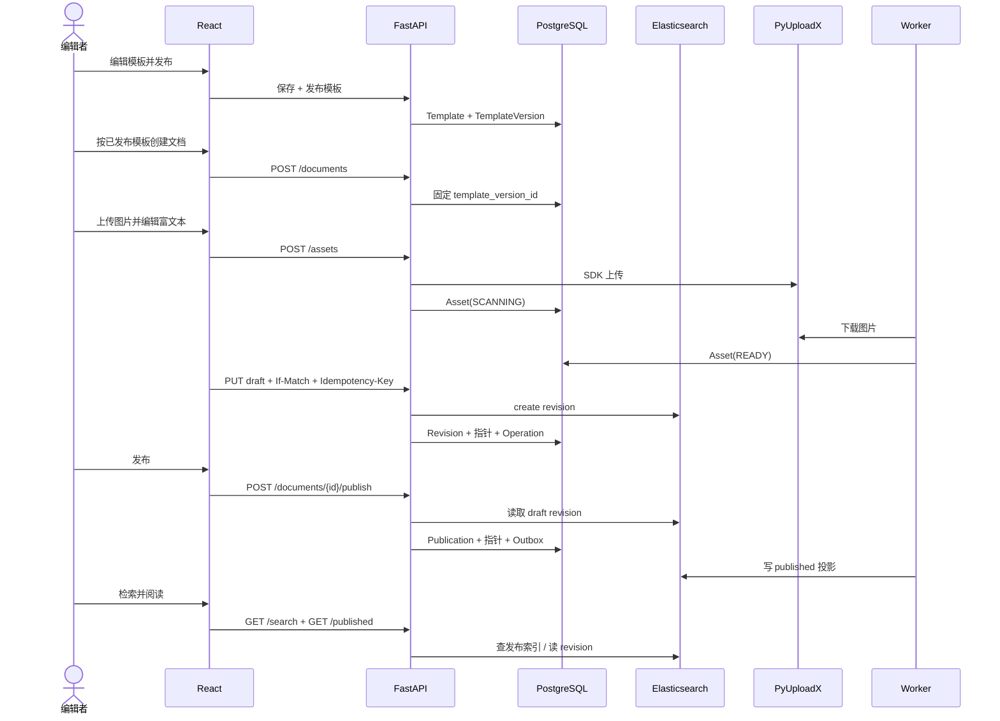

# DocCraft Engine 全引擎技术设计

> 文档状态：当前实现基线  
> 代码版本：`0.2.0`，提交 `10e0ab4`，分支 `dev-20261024`，标签 `v0.2.0`  
> 最后更新：2026-10-25  
> 适用读者：后端、前端、测试、运维，以及后续接手迭代的研发同事

本文描述 DocCraft Engine 当前真实可运行的完整设计，包括目标与边界、总体架构、数据结构、模板协议、文档生命周期、媒体链路、检索投影、动态数据源、前端交互、API、E2E 流程、一致性、安全、运维和测试。文中的“后续/未实现”不代表当前能力；培训时不得把规划项当作已交付功能。

动态选项数据源的更细实现、逐接口 curl 和扩展步骤见专题文档：[动态选项数据源技术实现](dynamic-option-source-implementation.md)。模板编辑器的操作步骤见：[模板编辑器使用指南](template-editor-guide.md)。前端视觉和交互基线见：[前端交互与视觉基线](frontend-interaction.md)。

## 1. 一页看懂

DocCraft 是模板驱动的知识采编、发布和检索平台。它解决的不是“做一个富文本页面”，而是把非结构化内容生产拆成四个可治理的层次：

1. **模板定义结构**：用稳定 ID 描述字段、布局、检索映射和必填阶段。
2. **文档采集内容**：按模板生成动态表单，正文以富文本 JSON AST 保存。
3. **版本隔离变更**：模板发布为不可变版本；文档创建时固定模板版本，不被模板后续修改影响。
4. **发布与检索分离**：草稿正文只追加写入 Elasticsearch revision；发布后在 PostgreSQL 记录发布事实，再由 Worker 异步生成检索投影。

当前黄金链路：

```text
创建/编辑模板
  → 校验模板结构与动态数据源
  → 发布不可变 TemplateVersion
  → 按已发布模板创建文档并固定 template_version_id
  → 编辑富文本/媒体/动态单选
  → If-Match + Idempotency-Key 保存草稿
  → 发布时重新执行 publish 阶段校验
  → PostgreSQL 写 Publication + Outbox
  → Worker 生成 ES published 投影
  → 阅读固定 published_revision_id，检索查询 published 索引
```

核心对象和一句话职责：

| 对象 | 职责 | 是否可修改 |
|---|---|---|
| `Template` | 当前草稿、控制版本、已发布版本指针 | 草稿可改，控制版本单调递增 |
| `TemplateVersion` | 发布时的规范源、编译结果、hash | 发布后不再由 API 修改 |
| `Document` | 文档身份、模板版本锚点、草稿/发布指针 | 指针和元数据可推进 |
| `Revision` | PG 中的正文元数据，正文本体在 ES | 只追加 |
| `Publication` | 一次发布事实与发布代数 | 只追加 |
| `Asset` | PyUploadX 对象引用、校验状态 | 状态可推进 |
| `Operation` | 幂等键、请求 hash、已提交响应 | 一次保存对应一条 |
| `OutboxEvent` | 待生成发布检索投影的可靠事件 | 状态可推进 |
| `OptionSource` | 业务表到选项值/显示名的映射 | 可编辑/停用 |

## 2. 目标、角色与边界

### 2.1 产品目标

- 让同一份内容模板可以驱动编辑表单、阅读视图和检索字段映射。
- 让模板变更和已有文档解耦，避免“改模板导致历史文档不可读”。
- 让草稿保存具备明确的并发冲突语义和幂等重试语义。
- 让正文、控制元数据和二进制对象各自落在合适的存储中，不引入跨系统伪事务。
- 让发布后的阅读不依赖异步检索投影是否已经完成。
- 为动态单选提供受控的业务表读取能力，模板不保存 SQL、表名或列名。

### 2.2 当前角色和身份

后端从请求头读取开发身份：

| 请求头 | 含义 | 默认值 |
|---|---|---|
| `X-DocCraft-Tenant` | 租户 ID | `DOCCRAFT_DEFAULT_TENANT=default` |
| `X-DocCraft-User` | 用户 ID | `DOCCRAFT_DEFAULT_USER=dev-user` |
| `X-DocCraft-Role` | 角色 | `DOCCRAFT_DEFAULT_ROLE=publisher` |

`DOCCRAFT_AUTH_MODE=dev` 允许缺少头时使用默认身份；其他模式下缺少身份返回 `401 UNAUTHENTICATED`，但当前尚未接入 OIDC/JWT、用户目录和权限系统。

当前发布权限角色集合为：`publisher`、`template_admin`、`kb_admin`、`tenant_admin`。其他角色可以读取本租户资源，但模板发布、文档发布、数据源新建/修改会被拒绝。

租户隔离是当前最重要的数据边界：模板、文档、资产、数据源均按 `tenant_id` 查询；跨租户访问按不存在处理，通常返回 `404`，避免泄露资源是否存在。

### 2.3 当前不包含的能力

以下能力未被当前代码交付，培训和排期时必须单独列出：

- 生产级身份提供方、细粒度 ACL、知识库/空间级授权、审计日志。
- 审核流、多人会签、自审限制、撤回、下线、发布回滚。
- revision 历史页面、冲突合并、自动保存、协同编辑。
- 资源删除/引用回收/孤儿对象对账、ClamAV、病毒库、音视频转码。
- 动态数据源的 label 快照、缓存、限流、数据源级 ACL、跨库 Provider。
- ES 全量重建 API、索引别名切换、Prometheus/OpenTelemetry、限流和熔断。
- 模板自由画布、Canva 式绝对定位、组件脚本或任意表达式。

## 3. 关键设计决策

| 决策 | 原因 | 直接后果 |
|---|---|---|
| 模板规范源使用 JSON，YAML 只做导入导出 | JSON 是 API、编译器和数据库的共同格式；YAML 适合人工编辑但不做第二套规范 | `template_versions.source` 永远是规范 JSON；YAML 导入后仍需保存草稿 |
| 模板发布生成不可变 `TemplateVersion` | 文档需要稳定锚点，模板继续编辑不能改变历史文档语义 | 文档固定 `template_version_id`，读文档使用该版本的 `source` |
| 文档正文只存 ES，PG 只存指针和元数据 | 避免 PG 大 JSON 与全文索引双写；revision 天然只追加 | PG 指针必须能找到 ES revision；ES 不可用时读取正文返回 503 |
| revision 先写 ES、再登记 PG 指针 | 保证“有效 PG 指针一定能找到正文”；反向顺序会产生悬空指针 | 允许 PG 提交失败后留下可清理的 ES 孤儿 revision |
| 发布事实与 Outbox 同事务写 PG | 避免 PG 已发布但检索事件丢失 | 发布成功不等于检索立即可见，存在 Worker 延迟 |
| 阅读固定 `published_revision_id` | 草稿编辑不能影响已发布内容 | 文档可同时拥有“已发布版本”和“更新中的草稿” |
| 保存草稿用 `If-Match` + `Idempotency-Key` | 前者解决并发覆盖，后者解决网络重试重复写 revision | 缺任一前置条件返回 428；同键异请求返回 409 |
| 编译 Schema 只覆盖布局/索引实际引用字段 | 允许保留历史字段和模板组织信息，避免无关字段阻断内容 | 孤儿字段不参与内容必填和类型校验 |
| 动态单选只保存 `sourceId` | 模板不可信任任意 SQL/表名；数据源配置集中治理 | 编译器无法静态生成枚举值，值有效性在发布时查库确认 |
| 文件只通过 DocCraft API 代理访问 | 浏览器不接触 PyUploadX API Key 和签名 URL | 下载增加 API 中转成本，但权限边界清晰 |
| 前端保持 `ikc-demo` 壳层 + `WeKnora` 内容密度 | 与现有产品线一致，降低学习成本 | 使用 React/Ant Design 自己实现视觉，不复制参考项目组件 |

## 4. 总体架构

### 4.1 逻辑架构



- **Web**：React 19、TypeScript、Vite、Ant Design、HashRouter。生产构建后由 FastAPI 托管 `frontend/dist`。
- **API**：FastAPI、Pydantic v2、SQLAlchemy 2 AsyncSession、psycopg 3。负责身份、模板、文档、资产、搜索、数据源接口。
- **Worker**：轮询图片扫描任务和 Outbox；使用 `FOR UPDATE SKIP LOCKED` 支持多 Worker 竞争消费。
- **PostgreSQL**：控制面、模板版本、文档指针、revision 元数据、发布记录、资产元数据、幂等操作、Outbox、业务字典。
- **Elasticsearch**：不可变草稿 revision 和发布检索投影。
- **PyUploadX**：二进制对象存储服务；DocCraft 不直连 S3/MinIO。

### 4.2 部署拓扑



Docker 镜像通过入口角色控制进程：

- `web`：启动 API、Worker、HAProxy；外部只映射 `5290`，API 只监听容器回环。
- `api`：只启动 API，适合独立扩缩容。
- `worker`：只启动 Worker，适合独立扩缩容。

PostgreSQL、Elasticsearch、PyUploadX 均为项目外部的本地服务；本仓库只负责连接、建表/建索引和业务调用，不把它们纳入 Compose 生命周期。

### 4.3 数据所有权与一致性边界

| 数据 | 唯一权威存储 | PG 中保留的内容 |
|---|---|---|
| 模板规范源 | `template_versions.source` / `templates.draft_source` | 完整 JSON |
| 文档草稿正文 | ES `*-revisions-v1` | revision ID、hash、index 名、代数 |
| 文档发布正文 | 与草稿共用不可变 revision | `published_revision_id` 指针 |
| 发布检索文档 | ES `*-published-v1` | 不复制；可重建 |
| 二进制对象 | PyUploadX | bucket、object key、file ID、大小、hash、状态 |
| 发布事实 | PostgreSQL `publications` | 完整发布记录 |
| 动态选项 | 业务表 + `option_sources` 配置 | 不复制选项 label |

当前**不承诺** PostgreSQL、Elasticsearch、PyUploadX 之间的分布式 ACID。系统通过写入顺序、指针、Outbox 和外部版本号把失败窗口限制在可识别、可清理的范围内：

- 草稿保存先写 ES revision，再提交 PG。ES 成功而 PG 失败会留下孤儿 revision，但没有文档指针引用它。
- 发布只提交 PG 事务；检索投影异步生成。发布后内容可立即从 revision 阅读，但检索存在延迟。
- 上传先写 PyUploadX，再提交 PG Asset。PG 失败会留下孤儿对象，当前没有自动回收器。
- 发布投影使用 `external_gte`，同一或更旧 generation 不会覆盖更新投影。

## 5. 领域数据模型

### 5.1 关系图



图中的部分关系是**逻辑关系**而非数据库外键：`documents.template_version_id`、`revisions.template_version_id`、`documents.draft_revision_id`、`documents.published_revision_id`、`publications.revision_id` 都没有 FK 约束。这样做的原因是 revision 正文在 ES，发布记录是事实日志；应用层负责保持引用有效。

### 5.2 表：`templates`

模板聚合根，保存当前草稿和发布指针。

| 字段 | 类型/约束 | 语义 |
|---|---|---|
| `id` | `varchar(80)` PK，`tpl_*` | 模板 ID |
| `tenant_id` | `varchar(80)`，索引 | 租户 |
| `name` | `varchar(200)` | 从草稿 `metadata.name` 冗余，列表展示 |
| `description` | `text` | 从草稿 `metadata.description` 冗余 |
| `draft_source` | `jsonb` | 当前规范模板 JSON |
| `control_version` | `int`，初始 1 | CAS 控制版本；每次保存草稿 +1 |
| `published_version_id` | `varchar(80)` | 最近成功发布的模板版本指针 |
| `created_by` | `varchar(80)` | 创建人 |
| `created_at` / `updated_at` | `timestamptz` | 时间 |

`templates` 没有数据库 `status` 列；API 视图中的 `status` 由 `published_version_id` 是否为空推导。已发布模板仍可继续编辑草稿，因此列表可能同时显示“已发布”和新的未发布草稿内容。

### 5.3 表：`template_versions`

不可变发布版本。

| 字段 | 类型/约束 | 语义 |
|---|---|---|
| `id` | `varchar(80)` PK，`tpv_*` | 版本 ID，文档固定引用它 |
| `template_id` | FK `templates.id`，`ON DELETE CASCADE` | 所属模板 |
| `version` | `int`，与 `template_id` 唯一 | 从 1 递增的展示版本号 |
| `source` | `jsonb` | 发布时的规范源 |
| `compiled` | `jsonb` | 编译结果：Schema、UI 树、索引计划等 |
| `template_hash` | `varchar(64)` | 规范 JSON 的 SHA-256 |
| `compiler_version` | `varchar(32)` | 当前 `1.1` |
| `published_by` | `varchar(80)` | 发布人 |
| `published_at` | `timestamptz` | 发布时间 |

API 没有修改/删除已发布版本的端点。数据库本身没有“禁止 UPDATE”的触发器，因此变更只能通过受控迁移完成，不能在业务代码中回写。

### 5.4 表：`documents`

文档身份、模板锚点和双指针。

| 字段 | 类型/约束 | 语义 |
|---|---|---|
| `id` | `varchar(80)` PK，`doc_*` | 文档 ID |
| `tenant_id` | `varchar(80)`，索引 | 租户 |
| `template_id` | FK `templates.id`，`ON DELETE RESTRICT` | 来源模板 |
| `template_version_id` | `varchar(80)` | 创建时固定的模板版本 |
| `title` | `varchar(300)` | 列表标题；保存时从模板标题字段同步 |
| `status` | `varchar(24)` | `draft` / `published`，表示是否曾发布 |
| `draft_revision_id` | `varchar(80)` | 当前草稿 revision 指针 |
| `published_revision_id` | `varchar(80)` | 当前已发布 revision 指针 |
| `draft_generation` | `int`，初始 0 | 草稿代数；保存时生成新的 revision no |
| `publication_generation` | `int`，初始 0 | 发布代数；每次发布 +1 |
| `control_version` | `int`，初始 1 | 草稿保存 CAS 版本；保存和发布都会 +1 |
| `created_by` | `varchar(80)` | 创建人 |
| `created_at` / `updated_at` | `timestamptz` | 时间 |

关键语义：

- `status=published` 不表示“草稿指针等于发布指针”。已发布文档继续编辑并保存草稿后，`status` 仍为 `published`，但 `draft_revision_id` 会领先于 `published_revision_id`。
- 阅读始终读取 `published_revision_id`；编辑器读取 `draft_revision_id`。
- 文档的模板版本固定，不随模板发布新版本变化。
- 保存时的 `control_version` CAS 和发布时的文档行锁共同串行化“保存/发布”两类写入。

### 5.5 表：`revisions`

ES 正文的 PG 元数据。

| 字段 | 类型/约束 | 语义 |
|---|---|---|
| `id` | `varchar(80)` PK，`rev_*` | revision ID，同时作为 ES `_id` |
| `document_id` | FK `documents.id`，`ON DELETE CASCADE` | 所属文档 |
| `revision_no` | `int`，与 `document_id` 唯一 | 文档内递增编号 |
| `template_version_id` | `varchar(80)` | 写 revision 时的模板版本，应与文档固定版本一致 |
| `content_hash` | `varchar(64)` | `values` 规范化 JSON 的 SHA-256 |
| `es_index` | `varchar(200)` | revision 所在索引名，当前为 `doccraft-revisions-v1` |
| `created_by` | `varchar(80)` | 保存人 |
| `created_at` | `timestamptz` | 保存时间 |

revision 只追加，不提供更新或删除 API。正文本身包含 `documentId`、`tenantId`、`revisionId`、`revisionNo`、`templateVersionId`、`contentHash`、`operationId`、`values`、`status=draft` 和 `createdAt`。

### 5.6 表：`publications`

发布事实日志。

| 字段 | 类型/约束 | 语义 |
|---|---|---|
| `id` | `varchar(80)` PK，`pub_*` | 发布记录 ID |
| `document_id` | FK `documents.id`，`ON DELETE CASCADE` | 文档 |
| `revision_id` | `varchar(80)` | 被发布的 revision |
| `generation` | `int` | 发布代数，从 1 递增 |
| `published_by` | `varchar(80)` | 发布人 |
| `published_at` | `timestamptz` | 发布时间 |

发布事务同时推进 `documents.published_revision_id`、`publication_generation`、`control_version`，并插入一条 `publish.index` Outbox 事件。

### 5.7 表：`assets`

媒体对象和校验状态。

| 字段 | 类型/约束 | 语义 |
|---|---|---|
| `id` | `varchar(80)` PK，`asset_*` | 资产 ID |
| `tenant_id` | `varchar(80)`，索引 | 租户 |
| `bucket` | `varchar(200)` | PyUploadX bucket |
| `object_key` | `text` | 生成的对象键 |
| `pyuploadx_file_id` | `varchar(80)`，索引 | PyUploadX 文件 ID |
| `original_name` | `varchar(300)` | 原始文件名 |
| `mime_type` | `varchar(200)` | 上传声明的 MIME |
| `size_bytes` | `int` | 实际流式统计大小 |
| `sha256` | `varchar(64)` | 文件内容 hash |
| `status` | `varchar(24)` | `SCANNING` / `READY` / `QUARANTINED` |
| `created_by` | `varchar(80)` | 上传人 |
| `created_at` / `updated_at` | `timestamptz` | 时间 |
| `error_message` | `text` | 图片校验失败原因 |

### 5.8 表：`operations`

草稿保存幂等记录。

| 字段 | 类型/约束 | 语义 |
|---|---|---|
| `id` | `varchar(80)` PK，`op_*` | 操作 ID，同时写入 ES revision |
| `tenant_id` | `varchar(80)` | 租户 |
| `idempotency_key` | `varchar(200)` | 请求头 `Idempotency-Key` |
| `operation` | `varchar(80)` | 当前为 `document.save` |
| `request_hash` | `varchar(64)` | 文档 ID + `values` 的规范化 hash |
| `status` | `varchar(24)` | 当前成功记录为 `COMMITTED` |
| `response` | `jsonb` | 首次成功响应，用于同键重放 |
| `created_at` / `updated_at` | `timestamptz` | 时间 |

唯一约束为 `(tenant_id, idempotency_key)`。同键同 hash 且已有响应时直接重放；同键不同 hash 返回 409。当前幂等记录与业务提交同事务写入，不做预占锁，极端并发依赖唯一约束兜底。

### 5.9 表：`outbox_events`

事务性 Outbox。

| 字段 | 类型/约束 | 语义 |
|---|---|---|
| `id` | `varchar(80)` PK，`evt_*` | 事件 ID |
| `tenant_id` | `varchar(80)` | 租户 |
| `event_type` | `varchar(80)` | 当前为 `publish.index` |
| `aggregate_id` | `varchar(80)` | 文档 ID |
| `payload` | `jsonb` | `documentId`、`revisionId`、`generation`、`publishedBy` |
| `status` | `varchar(24)` | `PENDING` / `PROCESSING` / `DONE` / `FAILED` |
| `attempts` | `int` | 已尝试次数 |
| `last_error` | `text` | 最近错误，截断到 2000 字符 |
| `created_at` / `updated_at` | `timestamptz` | 时间 |

索引 `(status, created_at)` 支持按创建时间扫描待处理事件。

### 5.10 表：`biz_region_city`

首个业务数据源示例表，默认种子为浙江省 11 个地市。

| 字段 | 类型/约束 | 语义 |
|---|---|---|
| `city_code` | `varchar(12)` PK | 地市代码，作为选项 value |
| `city_name` | `varchar(80)` | 地市名称，作为 label |
| `province_code` | `varchar(12)`，索引 | 省份代码 |
| `province_name` | `varchar(40)` | 省份名称 |
| `enabled` | `boolean` | 是否可被动态查询 |
| `sort_order` | `int` | 排序权重 |
| `updated_at` | `timestamptz` | 更新时间 |

### 5.11 表：`option_sources`

模板动态单选到业务表的映射。

| 字段 | 类型/约束 | 语义 |
|---|---|---|
| `id` | `varchar(80)` PK，`src_*` | 数据源 ID；模板只保存它 |
| `tenant_id` | `varchar(80)`，索引 | 租户 |
| `name` | `varchar(200)`，与租户唯一 | 展示名称 |
| `description` | `text` | 说明 |
| `provider` | `varchar(40)` | 当前只支持 `postgres_table` |
| `config` | `jsonb` | 表/值列/label 列/搜索列/启用列/排序 |
| `enabled` | `boolean` | 停用后不可查询，发布校验失败 |
| `created_by` | `varchar(80)` | 创建人 |
| `created_at` / `updated_at` | `timestamptz` | 时间 |

`config` 的规范形状：

```json
{
  "tableName": "biz_region_city",
  "valueColumn": "city_code",
  "labelColumn": "city_name",
  "searchColumns": ["city_name", "city_code"],
  "activeColumn": "enabled",
  "orderBy": ["sort_order", "city_code"]
}
```

### 5.12 ID 与时间约定

- 服务端业务 ID：`<prefix>_<32 位 uuid hex>`，例如 `doc_9f...`。
- 字段和布局区块 ID 必须匹配 `^[a-z][a-z0-9_]{1,63}$`，即 2–64 位、小写字母开头。
- 前端新字段使用 `f_<timestamp36><random>`，新区块使用 `b_...`；服务端仍按稳定 ID 正则校验。
- API 时间统一输出 UTC ISO 8601，例如 `2026-10-25T08:00:00Z`。

### 5.13 状态机



注意：图中的 `TemplatePublished` 是 API 派生状态，不是数据库列。模板发布后再次保存草稿不会清空 `published_version_id`，因此“最新草稿”和“最近发布版本”可以同时存在。

## 6. 模板协议与编译器

### 6.1 规范模板示例

下面是一个同时包含静态字段、富文本和动态单选的规范模板。实际 API 请求体为 `{ "source": <该对象> }`。

```json
{
  "schemaVersion": 1,
  "metadata": {
    "name": "地市产品知识",
    "description": "用于演示动态单选和富文本"
  },
  "fields": [
    {
      "id": "title",
      "type": "string",
      "label": "标题",
      "placeholder": "输入标题",
      "help": "",
      "requiredAt": ["submit", "publish"],
      "options": []
    },
    {
      "id": "city",
      "type": "enum",
      "label": "地市",
      "placeholder": "请选择地市",
      "help": "选项实时来自业务表",
      "requiredAt": ["publish"],
      "options": [],
      "optionsSource": { "sourceId": "src_zhejiang_cities" }
    },
    {
      "id": "body",
      "type": "richtext",
      "label": "正文",
      "placeholder": "",
      "help": "",
      "requiredAt": ["publish"],
      "options": []
    }
  ],
  "layout": {
    "id": "root",
    "kind": "stack",
    "title": "",
    "fieldId": null,
    "text": "",
    "children": [
      {
        "id": "sec_main",
        "kind": "section",
        "title": "文档内容",
        "fieldId": null,
        "text": "",
        "children": [
          {
            "id": "slot_title",
            "kind": "field",
            "title": "",
            "fieldId": "title",
            "text": "",
            "children": []
          },
          {
            "id": "slot_city",
            "kind": "field",
            "title": "",
            "fieldId": "city",
            "text": "",
            "children": []
          },
          {
            "id": "slot_body",
            "kind": "richText",
            "title": "",
            "fieldId": "body",
            "text": "",
            "children": []
          }
        ]
      }
    ]
  },
  "workflow": { "singleReview": true },
  "indexing": {
    "titleField": "title",
    "summaryField": "",
    "fullTextField": "body"
  }
}
```

`workflow.singleReview` 当前只是协议占位，没有审核流实现；不能据此认为系统已经支持审核。

### 6.2 字段类型与内容语义

| 类型 | 编译 JSON Schema | 内容校验 | 前端控件 |
|---|---|---|---|
| `string` | `string`，`maxLength=100000` | 字符串且不超过 100000 字符 | 单行输入 |
| `text` | `string`，`maxLength=100000`，`x-ui=textarea` | 同上 | 多行输入 |
| `enum` 静态 | `string` + `enum` | 必须等于某个静态 `options[].value` | 下拉选择 |
| `enum` 动态 | `string`，`maxLength=200` | 非空字符串；发布时查数据源确认仍然有效 | 远程搜索下拉 |
| `array` | `array<string>`，`maxItems=200` | 字符串数组，最多 200 项 | Tags 输入 |
| `object` | `object`，允许额外属性 | 任意 JSON 对象 | JSON 文本编辑 |
| `number` | `number` | int/float，且排除 bool | 数字输入 |
| `boolean` | `boolean` | 布尔值 | 开关 |
| `date` | `string`，`format=date` | `YYYY-MM-DD` 且能被 `date.fromisoformat` 解析 | 日期选择 |
| `asset` | `string`，`pattern=^asset_[a-f0-9]{32}$` | 合法 asset ID；保存/发布再检查资产状态 | 资产选择/上传 |
| `richtext` | `object`，`x-ui=richtext` | 必须是 `{ "type": "doc", ... }` | 富文本编辑器 |

字段定义约束：

- `fields` 至少 1 个、最多 200 个。
- 字段 `id` 必须匹配 `^[a-z][a-z0-9_]{1,63}$`，且模板内不能重复。
- `label` 必填，1–200 字符。
- `requiredAt` 可取 `draft`、`submit`、`publish` 的组合；当前 API 实际执行的是 `draft` 保存校验和 `publish` 发布校验，`submit` 已进入协议和 Schema，但没有单独提交端点。
- 静态 `enum` 与动态 `optionsSource` 互斥；动态 `enum` 可以没有静态 `options`。
- 只有 `enum` 可以配置 `options` 或 `optionsSource`。

### 6.3 布局区块与父子约束

| 区块 | 用途 | 允许的父容器 | 特殊约束 |
|---|---|---|---|
| `stack` | 纵向容器 | `stack` / `section` / `columns` | 至少一个子区块 |
| `section` | 有标题的分组 | `stack` / `columns` | 至少一个子区块 |
| `columns` | 自动适配分栏 | `stack` / `section` | 至少一个子区块；当前无列宽属性 |
| `field` | 绑定任意非富文本/非资产字段 | `stack` / `section` / `columns` | 必须引用字段，不能有子区块 |
| `richText` | 绑定 `richtext` 字段 | `stack` / `section` / `columns` | 字段类型必须为 `richtext` |
| `asset` | 绑定 `asset` 字段 | `stack` / `section` / `columns` | 字段类型必须为 `asset` |
| `staticText` | 不可编辑说明文字 | `stack` / `section` / `columns` | `text` 不能为空 |

根布局必须是 `stack`。遍历深度从 0 开始，深度大于 6 时拒绝。所有布局区块 ID 必须稳定且唯一。`columns` 在编辑页和阅读页用 `repeat(auto-fit, minmax(200px, 1fr))` 渲染，不是可自由设置比例的栅格系统。

前端拖拽会阻止把容器拖入自己的后代，避免形成环；但父子类型的最终合法性仍以服务端编译器为准。非法模板即使被前端构造出来，也会在保存、校验或发布时返回 `TEMPLATE_INVALID`。

### 6.4 活跃字段、孤儿字段与删除语义

“活跃字段”是同时满足任一条件的字段：

1. 被某个布局区块的 `fieldId` 引用；
2. 作为 `indexing.titleField`、`indexing.summaryField` 或 `indexing.fullTextField` 被引用。

编译器只为活跃字段生成属性 Schema、必填规则和 UI 字段信息。一个仍在 `fields[]` 中、但已经不被布局或索引引用的字段叫**孤儿字段**：

- 不参与内容必填、类型校验；
- 不会出现在编译后的 Schema/UI 树中；
- 如果旧内容仍带有该字段值，当前 `validate_content` 允许它原样保留，避免历史草稿立即无法保存；
- 只有内容里出现**完全未在 `fields[]` 声明**的 key，才会报告“未知字段”。

这解释了“删除区块后为什么旧字段仍可能在字段列表中出现”：编辑器删除区块时会删除不再被布局引用的字段，但会保护仍被索引引用的字段；历史草稿里的值不会自动清理。对孤儿字段的清理是后续迁移/管理能力，当前服务端校验已不会因为孤儿字段缺失或类型不符而阻断。

需要注意：编译结果中的 JSON Schema 使用 `additionalProperties:false`，只包含活跃字段；它比当前 API 的草稿校验更严格。外部系统如果直接执行该 Schema，应先把孤儿字段值清理掉，或改走 DocCraft API 校验。

### 6.5 编译产物

`compile_template(source)` 输出：

| 字段 | 语义 |
|---|---|
| `compilerVersion` | 当前 `1.1` |
| `templateHash` | 规范 JSON 的 SHA-256 |
| `source` | Pydantic 规范化后的模板 JSON |
| `schemas` | `draft` / `submit` / `publish` 三阶段 JSON Schema |
| `ui` | 布局树与字段展示元数据 |
| `view` | 当前与 `ui` 相同的视图树，预留独立渲染差异 |
| `indexPlan` | 标题/摘要/全文映射字段 |
| `dependencies` | 当前每个活跃字段对应空数组，预留依赖表达式 |

hash 的计算方式：

```text
sha256(JSON.stringify(canonical_source, sort_keys=true, compact_separators, ensure_ascii=false))
```

同一语义的 JSON 只要规范序列化后相同，就得到同一 hash；字段顺序和布局顺序仍会影响 hash，因为它们是模板语义的一部分。

### 6.6 校验失败诊断

编译和内容校验错误统一返回 `diagnostics`：

```json
{
  "code": "TEMPLATE_INVALID",
  "message": "模板校验失败",
  "traceId": "7a...",
  "diagnostics": [
    { "path": "layout.children[0].fieldId", "message": "字段不存在: body" }
  ]
}
```

常见诊断路径：

| 场景 | 典型 path |
|---|---|
| 字段 ID 非法/重复 | `fields[0].id` |
| 布局字段悬空 | `layout.children[...].fieldId` |
| 区块父子关系非法 | `layout...` |
| 根不是 stack | `layout` |
| 标题/摘要/全文字段不存在 | `indexing.titleField` 等 |
| 数据源不存在/停用 | `fields.<fieldId>.optionsSource` |
| 内容必填/类型错误 | `<fieldId>` |

### 6.7 YAML 导入导出

- 导入使用 `yaml.safe_load`，拒绝包含 `<<:` 的 merge key。
- 文件必须是 YAML 对象；解析后立即执行完整模板编译。
- 导入接口只返回规范 `source` 和 `compiled`，**不会创建或更新模板**。前端把结果放入编辑器并标记未保存，仍需保存草稿。
- 导出使用 `yaml.safe_dump`，`allow_unicode=true`、不排序键、宽度 100。
- YAML 是交换格式，不是第二份权威数据；数据库只保存规范 JSON。

## 7. 可视化模板设计器

### 7.1 页面结构

模板设计器采用三栏全高工作区：

- 左栏：组件面板，提供字段、富文本、媒体、分组、分栏、容器、说明文字 7 类组件。
- 中栏：白色画布卡片，按布局树渲染；拖动块显示落点，选中块显示操作条。
- 右栏：属性面板；未选中区块时显示模板名称、说明和检索字段；选中区块时显示结构操作和字段定义。

顶部工具条提供返回、撤销、重做、导入、导出、校验、保存、预览、发布。未保存时显示强调色状态点和“有未保存改动”；离开页面前会提示。

### 7.2 拖拽与键盘等价路径

- 使用原生 HTML5 drag/drop，不引入 `dnd-kit`。
- 可以从组件面板拖入，也可以把已有区块拖到其他容器或目标区块之前。
- 画布同时提供每区块上移/下移按钮，作为不使用鼠标拖拽时的等价路径。
- 拖拽只做结构变换；服务端负责最终父子关系、字段引用、深度和类型校验。
- 选中区块后可从属性面板切换引用字段、编辑标题/说明、上移/下移或删除。

### 7.3 撤销、重做和字段生命周期

- 每次提交模板变更前保存一份快照，保留最近 40 步。
- 工具栏按钮提供撤销/重做；当前只注册了按钮交互，没有全局 `Ctrl+Z`/`Ctrl+Shift+Z` 键盘监听。tooltip 中的快捷键说明属于界面提示，不是已实现键位绑定。
- 删除有子区块的容器会二次确认。
- 删除区块时，会从 `fields[]` 删除不再被剩余布局引用、且不被索引映射引用的字段。
- 删除字段时，如果字段仍被布局引用，前端阻止删除；如果字段是标题索引字段，也阻止删除。
- 删除摘要/全文字段会同步清空对应 `indexing` 映射；标题字段必须显式切换。
- 修改字段类型会自动把布局中的区块类型同步为 `field`、`richText` 或 `asset`，避免保存时出现类型不匹配。

### 7.4 字段属性编辑

字段编辑器支持：

- 字段名称、占位文案、帮助文案；
- 10 种字段类型；
- `requiredAt` 三阶段复选；
- 单选静态选项逐行输入；
- 单选绑定系统数据源；
- 字段 ID 展示，不鼓励在已有内容后随意识别变更。

静态单选选项格式为每行 `value|label`；省略 `|` 时 value 与 label 相同。选项编辑器按行维护，允许输入多个值，不使用只接受单个值的输入框。动态单选选择数据源后，模板只保存 `sourceId`，不保存表名和列名。

### 7.5 预览、校验、保存与发布

- 预览支持表单和阅读两种模式；当前是基础结构预览，不是完整阅读器。
- “校验”调用服务端校验接口，不隐式保存。
- “保存”使用 `If-Match` 提交草稿；服务端返回新的 ETag。
- 保存发生 412 时，页面弹窗要求重新加载或保留本地，不做自动合并。
- “发布”在当前有未保存改动时先保存，再校验，再创建不可变版本。
- YAML 导入只替换本地编辑状态，不直接覆盖服务端模板。

### 7.6 模板 E2E 时序



## 8. 文档生命周期

### 8.1 创建文档

`POST /api/v1/documents` 只接受 `templateId` 和初始 `title`。服务端：

1. 校验模板属于当前租户。
2. 查询 `published_version_id`；没有发布过则返回 `409 TEMPLATE_NOT_PUBLISHED`。
3. 把 `template_version_id` 固定为当前发布版本。
4. 创建 `status=draft`、`control_version=1`、两个 generation 都为 0 的文档。
5. 返回该版本模板源，前端据此生成表单。

创建时不会写 ES revision；第一次保存草稿才产生正文。

### 8.2 读取草稿

`GET /api/v1/documents/{id}` 返回：

- 文档元数据和当前控制版本（同时作为 `ETag`）；
- 固定模板版本的 `templateSource`；
- 如果存在 `draft_revision_id`，从 ES 读取该 revision 的 `values` 作为 `content`；
- 如果 ES 不可用，返回 `503 BODY_UNAVAILABLE`，不会用 PG 中的旧数据伪造正文。

编辑器加载文档时还会并行读取媒体库，用于资产选择控件。

### 8.3 保存草稿：精确步骤



逐步说明：

1. `If-Match` 缺失返回 `428 PRECONDITION_REQUIRED`；不是数字返回 `400 INVALID_ETAG`。
2. `Idempotency-Key` 缺失返回 `428 IDEMPOTENCY_REQUIRED`。
3. 计算 `request_hash = sha256({"documentId": id, "values": values})`。
4. 查询 `(tenant_id, idempotency_key)`：同 hash 且有响应则直接重放；不同 hash 返回 409。
5. 对文档行执行 `SELECT ... FOR UPDATE`，并比较 `control_version`；旧值返回 `412 VERSION_CONFLICT`。
6. 读取文档固定的 `TemplateVersion.source`，执行 `validate_content(..., stage="draft")`。
7. 递归扫描内容中的 `asset_*` ID 或 `{assetId}` 字段，要求资产属于当前租户且状态为 `READY`。
8. 生成 `rev_*` ID、`revision_no = draft_generation + 1`、规范化内容 hash。
9. 以 `op_type=create` 写 ES revision，并 `refresh=wait_for`；写入成功后才登记 PG。
10. 更新文档草稿指针、草稿 generation 和 `control_version`，插入 Revision 和 Operation，提交 PG。
11. 如果标题索引字段有非空值，同步到 `documents.title`，最长截断到 300 字符。

保存失败窗口：

- ES 写失败：返回 503，PG 不变。
- ES 写成功、PG 提交失败：PG 没有指针引用该 revision，形成可清理孤儿；当前没有孤儿扫描器。
- 同键并发请求在提交前都看不到 Operation 时，唯一约束会阻止两条幂等记录；当前没有显式把唯一冲突映射回幂等响应，属于后续加固点。

### 8.4 幂等语义

`Idempotency-Key` 的作用域是租户，不限于单个文档；因此推荐使用每次保存新生成的 UUID。前端每次调用 `saveDocument` 都生成 `crypto.randomUUID()`。

同一键：

- 同 `request_hash` 且已有响应：返回第一次保存的响应和对应 ETag，不新增 revision。
- 同 `request_hash` 但没有响应：当前实现会继续执行保存流程。
- 不同 `request_hash`：返回 `409 IDEMPOTENCY_CONFLICT`。

这不是通用的 HTTP 幂等框架，只覆盖 `document.save`。

### 8.5 发布文档：精确步骤



发布要求：

- 当前身份必须有发布权限。
- 文档必须有 `draft_revision_id`，否则 `409 EMPTY_DRAFT`。
- Revision 和 TemplateVersion 元数据必须存在。
- ES 中必须存在对应 revision，ES 不可用返回 503。
- 按 `publish` 阶段重新校验必填和类型，不信任草稿阶段的结果。
- 动态 `enum` 的值必须仍能由数据源解析；数据源停用、选项删除或值不属于数据源都会返回 `422 CONTENT_INVALID`。
- 内容引用的所有资产必须仍为 `READY`；保存后资产被隔离会阻断发布。
- 发布接口不要求 `If-Match`，通过文档行锁和 `control_version` 递增串行化。

发布事务不修改 revision 字节，只把“哪个 revision 是已发布版本”这一事实写入 PG。`publication_generation` 每次发布 +1，作为发布投影的单调 external version。

### 8.6 阅读已发布文档

`GET /api/v1/documents/{id}/published`：

1. 校验文档属于当前租户。
2. 必须有 `published_revision_id`，否则 `404 NOT_PUBLISHED`。
3. 从 ES 读取该 revision；ES 不可用返回 503，正文丢失返回 `404 BODY_MISSING`。
4. 返回内容以及文档固定模板版本的 `source`。

阅读端不读取 `draft_revision_id`。因此编辑草稿不会改变已发布阅读内容，直到再次发布。

动态单选在阅读端展示的是**当前**数据源 label，而不是发布时快照。前端调用 `resolve` 接口解析已选 value；如果业务表已删除该 value，会回退显示原始 value。当前没有 label 快照表。

### 8.7 并发语义

| 并发场景 | 结果 |
|---|---|
| 两个保存请求携带同一旧 ETag | 行锁串行化；第一个成功，第二个看到新 control version 返回 412 |
| 保存与发布并发 | 谁先取得行锁谁先执行；若发布先完成，随后保存因 ETag 过期返回 412 |
| 两个发布请求并发 | 行锁串行化；都基于各自看到的最新草稿发布，各自生成 publication generation |
| 同幂等键并发保存 | 依赖 operations 唯一约束兜底；当前未实现占位式并发重放 |

### 8.8 revision 和发布历史边界

- revision 只追加，ES `_id` 为 revision ID，写入使用 create-only。
- `publications` 只追加，每次发布一条。
- 当前没有 revision 列表/历史查看/回滚 API，也没有“用历史 revision 重新发布”的 UI。
- 文档删除、模板删除、发布撤回都不在当前 API 中。

## 9. 富文本、表格与表单控件

### 9.1 编辑器实现

富文本编辑器使用 React 包装 `contentEditable`：

1. 后端 JSON AST → HTML 字符串，写入可编辑 DOM。
2. 用户输入时，从 DOM 反向序列化为 JSON AST，再通过 `onChange` 更新文档 values。
3. 图片节点只保存 `assetId` 和 `alt`；显示时通过 DocCraft 资产内容 API 获取 Blob URL，并在组件卸载时释放。
4. 保存草稿时只发送 AST 和 asset ID，不发送 Blob URL。

这是显式序列化方案，不依赖 Tiptap、ProseMirror 或 `dnd-kit`。当前使用浏览器 `document.execCommand`，兼容现有浏览器但属于逐步淘汰的 Web API，后续替换编辑器内核时需保持 AST 兼容。

### 9.2 AST 节点

当前 AST 根为：

```json
{ "type": "doc", "content": [] }
```

支持的节点/标记：

| 类型 | 结构 |
|---|---|
| 段落 | `paragraph` + inline content |
| 标题 | `heading` + `attrs.level`（DOM 解析支持 1–3，工具栏当前插入 H2） |
| 无序/有序列表 | `bulletList` / `orderedList` → `listItem` → `paragraph` |
| 引用 | `blockquote` → `paragraph` |
| 表格 | `table` → `tableRow` → `tableCell`，表头单元格 `attrs.header=true` |
| 图片 | `image` + `attrs.assetId` / `attrs.alt` |
| 硬换行 | `hardBreak` |
| 文本 | `text` + 可选 `marks` |

标记解析支持 `bold`、`italic`、`code`、`link`。工具栏当前直接提供加粗、斜体、H2、无序列表、有序列表、引用、链接、图片和表格操作；inline code 与 H1/H3 可以从粘贴 HTML 进入 AST，但没有独立按钮。

表格 AST 示例：

```json
{
  "type": "table",
  "content": [
    {
      "type": "tableRow",
      "content": [
        {
          "type": "tableCell",
          "attrs": { "header": true },
          "content": [
            { "type": "paragraph", "content": [{ "type": "text", "text": "列 1" }] }
          ]
        }
      ]
    }
  ]
}
```

### 9.3 表格交互规范

- 插入表格使用 Ant Design 居中 Modal，不使用浏览器原生 prompt/confirm。
- 行数 1–20，列数 1–10；首行作为表头。
- 打开 Modal 前保存编辑选区，插入后恢复选区；关闭后把光标放到新表格第一个单元格。
- 增行、增列、删表均为纯图标按钮，不带文字；每个按钮同时提供 `aria-label` 和 tooltip。
- 增行：在当前单元格所在行之后插入同样列数的新行。
- 增列：在当前单元格列之后插入新列；表头行同步添加表头单元格。
- 删表：删除当前光标所在表格。
- 表格操作按钮使用 `onMouseDown preventDefault` 保持编辑区选区。

链接编辑使用与表格一致的居中 Modal，提供“显示文字”和“链接地址”两个输入框；支持 http(s)、mailto、tel、站内相对路径和完整域名。插入时保留编辑选区，并用显式 DOM Range 写入 `<a>`，不调用浏览器原生对话框。链接地址会拒绝 `javascript:` 等不在允许范围内的协议。

### 9.4 阅读渲染边界

阅读器渲染当前 AST 支持的段落、H2/H3、无序/有序列表、引用、表格、图片、hardBreak，以及文本 marks：加粗、斜体、行内代码和链接。链接使用主题色下划线样式，HTTP(S) 链接在新窗口打开并带 `noopener noreferrer`；阅读态还会再次过滤 `javascript:` 等危险协议。图片通过资产 API 加载 Blob，加载中和失败都有文字状态。未知节点按子节点递归降级展示。

### 9.5 文档表单控件

| 字段类型 | 编辑控件 | 备注 |
|---|---|---|
| string/text | Input / TextArea | 直接绑定字符串 |
| enum 静态 | Select | 选项来自模板 |
| enum 动态 | 远程搜索 Select | 250ms 防抖，最多加载 50 项 |
| array | Select tags | 回车添加字符串 |
| number | InputNumber | 数值 |
| boolean | Switch | 布尔 |
| date | DatePicker | 输出 `YYYY-MM-DD` |
| object | JSON TextArea | 非法 JSON 就地报错 |
| asset | 资产选择器 | 可上传、轮询扫描状态、打开、替换、移除 |
| richtext | RichTextEditor | JSON AST |

前端只把非空值放入“发布前本地检查”的必填计算；最终是否允许发布仍以服务端响应为准。

## 10. 媒体链路与 PyUploadX

### 10.1 上传流程



关键约束：

- 默认最大文件 50 MiB，可通过 `DOCCRAFT_MEDIA_MAX_BYTES` 调整。
- MIME allowlist 默认：PNG、JPEG、WEBP、GIF、PDF、MP4、MPEG 音频、纯文本。
- 上传时按 1 MiB 分块读取到临时文件，同时累计大小和 SHA-256。
- 空文件返回 `400 EMPTY_FILE`，超限返回 `413 FILE_TOO_LARGE`，存储返回大小不一致返回 `502 STORAGE_SIZE_MISMATCH`。
- 对象键：`doccraft/{env}/{tenant}/assets/{assetId}/{safeName}`。
- 图片初始 `SCANNING`；非图片直接 `READY`。
- 图片 Worker 使用 Pillow `verify()`，再次检查像素数不超过 40,000,000，格式必须在 PNG/JPEG/WEBP/GIF 内。

### 10.2 下载流程

浏览器请求 `GET /api/v1/assets/{id}/content`：

1. API 校验资产租户和 `READY` 状态。
2. 通过 `pyuploadx.Client.download` 下载到临时文件。
3. 以 `FileResponse` 流式返回，并在后台删除临时文件。
4. 中文文件名使用 RFC 5987：回退 ASCII `filename` + `filename*=UTF-8''...`。
5. 添加 `Cache-Control: private, max-age=300` 和 `X-Content-Type-Options: nosniff`。

浏览器不直接访问 PyUploadX，不接触 API Key；当前也不持久化 PyUploadX 签名 URL。

### 10.3 当前媒体边界

- `PyUploadXStorage` 已封装 `delete`，但 API 没有资产删除端点，也没有引用计数回收。
- 非图片资产没有内容级深度检测；当前仅依赖客户端 MIME 和 allowlist。
- 没有 ClamAV、EXIF 清洗、图片重编码、音视频转码、缩略图派生对象。
- 没有上传后 PG 失败的对象回收器，也没有 PyUploadX 超时后的自动对账任务。
- 资产列表最多返回 200 条，没有分页。

## 11. Elasticsearch、检索与 Worker

### 11.1 索引

默认前缀 `doccraft`：

| 索引 | 内容 | 写入 ID | 用途 |
|---|---|---|---|
| `doccraft-revisions-v1` | 不可变草稿 revision | revision ID | 读取草稿/发布正文 |
| `doccraft-published-v1` | 发布检索投影 | document ID | 搜索 |

两个索引共同设置：

- `dynamic: strict`
- `number_of_shards=1`、`number_of_replicas=0`
- `title`、`summary`、`fullText` 使用 `cjk` analyzer
- `values`、`fieldTypes` 为 `object` 且 `enabled=false`，只存储不检索

revision 文档的 `values` 不参与 ES 索引，正文检索依赖 Worker 生成的 published 投影。

### 11.2 revision 写入

- 路径：`PUT /{revision_index}/_doc/{revisionId}?op_type=create&refresh=wait_for`
- create-only 防止同一 revision ID 被覆盖。
- `refresh=wait_for` 保证写入返回后立即可读，代价是额外刷新延迟。

### 11.3 发布投影

Worker 处理 `publish.index` 事件：

1. 读取 Document、Revision、TemplateVersion。
2. 从 revisions 索引读取正文。
3. 调用 `build_search_document` 构造投影。
4. 以 `documentId` 为 `_id` 写入 published 索引。
5. 使用 `version=generation` + `version_type=external_gte`，防止旧投影覆盖新投影。

`build_search_document` 的字段策略：

- `title` 使用文档标题。
- `summary` 使用 `indexing.summaryField`；富文本会转纯文本。
- `fullText` 初始为标题。
- 如果配置了 `fullTextField` 且该字段非空，使用该字段的纯文本。
- 如果配置字段存在但结果为空，回退拼接所有字符串/富文本值。
- 如果没有配置 `fullTextField`，默认只有标题进入 `fullText`，其他表格/段落字段不会自动全文索引。

最后一条是当前检索语义的关键限制：想让正文可搜，发布模板时必须显式配置 `indexing.fullTextField`。

### 11.4 Worker 调度

Worker 单轮：

- 资产：最多领取 4 个 `SCANNING`，按创建时间排序，`FOR UPDATE SKIP LOCKED`。
- Outbox：最多领取 8 个 `PENDING`，按创建时间排序，`FOR UPDATE SKIP LOCKED`。
- 没有工作时等待 `DOCCRAFT_WORKER_POLL_SECONDS`，默认 1.5 秒。
- 支持 SIGTERM/SIGINT 优雅停止。

Outbox 失败策略：

- 领取后先写 `PROCESSING` 并提交，再执行索引。
- 成功写 `DONE`；失败且 `attempts < 8` 回到 `PENDING`；达到 8 次写 `FAILED`。
- 当前没有 `PROCESSING` 超时回收；进程在索引过程中崩溃可能留下永久 `PROCESSING` 事件，需要后续增加超时扫描或重建命令。

资产失败策略：任何下载、Pillow 校验、像素或格式异常都会把资产置为 `QUARANTINED` 并记录 `error_message`，不会重试同一坏文件。

### 11.5 检索接口行为

`GET /api/v1/search?q=&limit=`：

- `q` 最长 300；`limit` 默认 20，范围 1–50。
- 过滤 `tenantId` 和 `status=published`。
- 有查询时对 `title^4`、`summary^2`、`fullText` 执行 `best_fields` multi-match。
- 空查询使用 `match_all`。
- 高亮标题、摘要、全文，全文片段 160 字符。
- 按 `generation` 倒序。
- 返回 `documentId`、`title`、`summary`、`score`、`highlight`。

检索索引是异步投影，不是发布事务的一部分；发布成功后短时间内可能搜不到，属于设计边界而不是数据丢失。当前没有索引重建 API、别名切换、删除文档投影或按模板过滤。

## 12. 动态选项数据源

### 12.1 设计目标

静态选项写在模板里适合稳定枚举，但不适合组织、地市、产品、项目等系统主数据。动态数据源解决的是：

- 模板只绑定数据源 ID，不保存表名、列名和 SQL；
- 选项由服务端从受控业务表实时查询；
- 前端远程搜索，不把整张表加载到浏览器；
- 保存草稿宽松，发布时严格确认值仍有效；
- 所有查询强制租户边界和标识符白名单。

当前只支持 `provider=postgres_table`，并且只查当前数据库、当前 schema 下以 `biz_` 开头的表。

### 12.2 数据源配置

`option_sources.config` 的语义：

| 字段 | 约束 | 作用 |
|---|---|---|
| `tableName` | 必填，`^biz_[a-z][a-z0-9_]{0,59}$` | 业务表 |
| `valueColumn` | 必填，合法标识符 | 保存到文档的值 |
| `labelColumn` | 必填，合法标识符 | 展示给用户的名称 |
| `searchColumns` | 最多 8 个 | 远程搜索使用 `LOWER(CAST(col AS TEXT)) LIKE` |
| `activeColumn` | 可选 | 条件为 `active_col IS TRUE` |
| `orderBy` | 最多 8 个，无方向后缀 | 默认 `labelColumn,valueColumn` |

标识符必须匹配 `^[a-z][a-z0-9_]{0,63}$`，服务端再次加双引号。表名、列名不能来自请求中的任意 SQL；查询值通过参数绑定。由于 `ORDER BY` 不能直接绑定列名，它只接受白名单标识符并用双引号拼接。

保存数据源时，服务端通过 `information_schema` 校验表存在、字段存在，但不校验字段类型。业务表应自行保证 value/label 可安全转为文本。

### 12.3 模板绑定与客户端

动态单选字段：

```json
{
  "id": "city",
  "type": "enum",
  "label": "地市",
  "requiredAt": ["publish"],
  "options": [],
  "optionsSource": { "sourceId": "src_zhejiang_cities" }
}
```

编译器对动态 `enum` 只生成 `{ "type": "string", "maxLength": 200 }`，不能生成静态 `enum`。这保证了模板可以独立编译；值是否有效要到发布时查库确认。

前端远程搜索：

- 用户输入后 250ms 防抖；
- `GET /option-sources/{id}/options?query=...&limit=50`；
- 已选值不在当前搜索结果时，调用 `resolve` 补入 label；
- 数据源不可用时就地显示错误，不阻断其他字段编辑。

### 12.4 草稿与发布差异

| 阶段 | 行为 |
|---|---|
| 模板创建/保存/校验/发布 | 检查 `sourceId` 存在且启用；不存在或停用返回 422 |
| 文档保存草稿 | 动态值只做字符串长度校验，不查业务表 |
| 文档发布 | 按字段值批量 `resolve`，值不存在或数据源停用返回 422 |
| 阅读已发布文档 | 前端实时 `resolve` 当前 label；缺失时回退原始 value |

草稿宽松是刻意的：业务表可能在编辑期间重建或短暂不可用，不应让编辑者无法保存；发布是承诺公开内容质量的门槛，因此严格。

### 12.5 浙江地市种子

`migrations/002_option_sources.sql` 和开发种子会写入：

| city_code | city_name |
|---|---|
| `330100` | 杭州市 |
| `330200` | 宁波市 |
| `330300` | 温州市 |
| `330400` | 嘉兴市 |
| `330500` | 湖州市 |
| `330600` | 绍兴市 |
| `330700` | 金华市 |
| `330800` | 衢州市 |
| `330900` | 舟山市 |
| `331000` | 台州市 |
| `331100` | 丽水市 |

默认数据源 ID 为 `src_zhejiang_cities`，租户为 `default`。生产环境不能依赖开发种子，应由迁移流程显式写入或由业务初始化任务创建。

### 12.6 当前边界

- 没有 label 快照，已发布文档的显示名会随业务表变化。
- 没有查询缓存、限流、熔断；每次搜索和发布校验都会查库。
- 没有数据源级 ACL，只有租户和发布角色控制。
- 没有删除 API；通过 `PUT` 设置 `enabled=false` 停用。
- 不支持跨库、HTTP Provider、级联选项、互斥选项或依赖表达式。
- 业务表删除/改名后，已经绑定它的模板会变成不可保存/不可发布状态，需要先修数据源配置。

完整 SQL 安全分析、逐接口示例和扩展 Provider 的步骤见专题文档第 2–6、11–13 节：[动态选项数据源技术实现](dynamic-option-source-implementation.md)。

## 13. 前端设计与交互

### 13.1 应用壳层

前端采用 HashRouter，路由不依赖服务端 rewrite；生产环境仍由 FastAPI 托管静态文件。侧栏分组：

- 工作台：概览、模板、文档、检索；
- 资源：媒体库、数据源。

壳层包含可折叠侧栏、品牌区、主题切换、API 在线状态和版本号。四套主题为 `light`、`dark`、`high-contrast`、`green`，通过 `data-theme` + Ant Design `ConfigProvider` 切换，主题和侧栏折叠状态写入 `localStorage`。

视觉基线：

- 壳层、导航、主题变量沿用 `ikc-demo`；
- 页头、工具条、卡片密度、空状态、抽屉、消息反馈沿用 `WeKnora`；
- 不使用 Vue/TDesign，也不复制参考项目组件代码；在 React + Ant Design 内实现同等交互语言。

### 13.2 页面清单

| 路由 | 页面 | 主要能力 |
|---|---|---|
| `#/` | 概览 | 模板/文档/资产统计、最近文档、快捷入口 |
| `#/templates` | 模板列表 | 搜索、状态筛选、新建、进入设计器 |
| `#/templates/:templateId` | 模板设计器 | 拖拽布局、字段编辑、校验、预览、YAML、发布 |
| `#/documents` | 文档列表 | 搜索、状态筛选、按已发布模板新建 |
| `#/documents/:documentId` | 文档编辑器 | 动态表单、富文本、媒体、保存、发布、阅读 |
| `#/search` | 检索 | ES 查询、高亮、进入文档 |
| `#/assets` | 媒体库 | 上传、筛选、预览、状态展示 |
| `#/data-sources` | 数据源管理 | 新建/编辑/停用、选项预览 |

`#/documents?create=1` 会直接打开“新建文档”弹窗，供概览页快捷入口使用。

### 13.3 前端状态与 API 封装

- 没有 Redux/Zustand；页面内 `useState`/`useMemo` 管理状态，跨页面只共享主题和 Shell 会话信息。
- `frontend/src/api.ts` 统一设置 `X-DocCraft-*` 开发身份头、JSON 序列化、错误解析和 ETag 读取。
- 所有写请求的失败通过 `ApiError` 暴露 `status` 和 payload；412 走冲突弹窗，422 展示 `diagnostics`。
- 保存和发布时有局部 loading，避免重复提交。
- 模板和文档编辑器在 dirty 时注册 `beforeunload`，返回按钮还会执行一次确认。

### 13.4 列表页交互

- 卡片网格使用自适应列宽；移动端单列。
- 模板、文档、资产均支持页内搜索；模板和文档有状态 segmented 筛选。
- 空状态根据原因区分“没有数据”和“搜索无结果”，并提供清除筛选或创建入口。
- 媒体卡片在 `SCANNING` 状态显示处理中样式，并轮询刷新。
- 数据源列表展示表名和字段映射，抽屉中预览前 20 个选项。

### 13.5 可访问性与响应式

- 图标按钮提供 `aria-label` 和 tooltip；表格操作按钮不显示文字。
- 可点击卡片支持 Enter/Space 键盘进入。
- 编辑器在 1200px 以下收窄右侧属性区，900px 以下改为抽屉/单列；已在 1440、1024、390px 验证无横向溢出。
- `prefers-reduced-motion` 下关闭非必要动画。
- 当前没有 axe 自动扫描和完整键盘 E2E，属于测试缺口。

### 13.6 已知前端边界

- 全局撤销/重做快捷键未绑定，仅按钮可用。
- 没有 revision 历史、草稿自动保存、冲突合并、模板移动端专用预览。
- 写入 URL 的分页/排序没有实现，列表数量受 API 限制。

## 14. 完整 API 目录

### 14.1 通用约定

- API 前缀：`/api/v1`；健康检查为根路径 `/healthz`、`/readyz`。
- FastAPI OpenAPI：`http://127.0.0.1:8100/docs`，机器可读定义：`/openapi.json`。
- 请求头身份：`X-DocCraft-Tenant`、`X-DocCraft-User`、`X-DocCraft-Role`。
- JSON 接口使用 `Content-Type: application/json`；资产上传使用 `multipart/form-data`。
- 时间输出为 UTC ISO 8601。
- 模板保存和文档读取/保存返回 `ETag: "<controlVersion>"`。
- 需要 CAS 的写请求使用 `If-Match: "<controlVersion>"`；引号可有可无，但推荐保留。
- 文档草稿保存额外要求 `Idempotency-Key`，数据库长度上限 200。
- CORS 允许来源由 `DOCCRAFT_CORS_ORIGINS` 配置；暴露 `ETag` 和 `X-Trace-Id`。
- 每个响应带 `X-Trace-Id`；请求可自带该头，否则服务端生成。

错误响应统一形状：

```json
{
  "code": "VERSION_CONFLICT",
  "message": "文档已被其他会话更新",
  "traceId": "9d5c...",
  "currentVersion": 3,
  "diagnostics": []
}
```

`diagnostics[]` 只在模板或内容校验错误时存在；其他附加字段按错误类型提供（例如 `currentVersion`、`assetIds`）。

### 14.2 端点总表

| # | 方法 | 路径 | 能力 | 权限/前置条件 |
|---|---|---|---|---|
| 1 | GET | `/healthz` | 进程存活 | 无 |
| 2 | GET | `/readyz` | PG/ES/PyUploadX 就绪 | 无 |
| 3 | GET | `/api/v1/session` | 会话展示信息 | 无 |
| 4 | GET | `/api/v1/templates` | 模板列表 | 租户身份 |
| 5 | POST | `/api/v1/templates` | 创建模板草稿 | 租户身份 |
| 6 | GET | `/api/v1/templates/{id}` | 模板详情/草稿/编译结果 | 租户身份 |
| 7 | PUT | `/api/v1/templates/{id}/draft` | 保存模板草稿 | `If-Match` |
| 8 | POST | `/api/v1/templates/{id}/validate` | 校验模板 | 租户身份 |
| 9 | POST | `/api/v1/templates/{id}/publish` | 发布模板版本 | 发布角色 |
| 10 | GET | `/api/v1/templates/{id}/export.yaml` | 导出 YAML | 租户身份 |
| 11 | POST | `/api/v1/templates/import/yaml` | 解析并校验 YAML | 租户身份 |
| 12 | GET | `/api/v1/documents` | 文档列表 | 租户身份 |
| 13 | POST | `/api/v1/documents` | 创建文档 | 模板已发布 |
| 14 | GET | `/api/v1/documents/{id}` | 读取草稿文档 | 租户身份 |
| 15 | PUT | `/api/v1/documents/{id}/draft` | 保存草稿 | `If-Match` + `Idempotency-Key` |
| 16 | POST | `/api/v1/documents/{id}/publish` | 发布文档 | 发布角色 |
| 17 | GET | `/api/v1/documents/{id}/published` | 读取发布文档 | 已发布 |
| 18 | GET | `/api/v1/assets` | 资产列表 | 租户身份 |
| 19 | POST | `/api/v1/assets` | 上传资产 | `file` 文件字段 |
| 20 | GET | `/api/v1/assets/{id}` | 资产详情 | 租户身份 |
| 21 | GET | `/api/v1/assets/{id}/content` | 代理下载内容 | 资产 `READY` |
| 22 | GET | `/api/v1/search` | 检索发布文档 | 租户身份 |
| 23 | GET | `/api/v1/option-sources` | 数据源列表 | 租户身份 |
| 24 | POST | `/api/v1/option-sources` | 新建数据源 | 发布角色 |
| 25 | PUT | `/api/v1/option-sources/{id}` | 修改/停用数据源 | 发布角色 |
| 26 | GET | `/api/v1/option-sources/{id}/options` | 查询选项 | 租户身份 |
| 27 | POST | `/api/v1/option-sources/{id}/resolve` | 解析已选 value 的 label | 租户身份 |

### 14.3 系统接口

#### `GET /healthz`

只证明 API 进程可响应，不检查外部依赖。

```json
{ "status": "ok", "service": "doccraft-engine", "version": "0.2.0" }
```

#### `GET /readyz`

依次调用 PostgreSQL `select 1`、ES 根接口、PyUploadX `list_files`。全部成功返回 200：

```json
{
  "status": "ok",
  "checks": { "postgres": "ok", "elasticsearch": "ok", "pyuploadx": "ok" }
}
```

全部成功时返回 `{ "status": "ready", "checks": {...} }`；任一失败返回 `503 NOT_READY`，并给出各依赖状态。Docker `HEALTHCHECK` 使用 `/healthz` 而不是 `/readyz`，避免外部依赖短暂抖动导致容器被反复重启。

#### `GET /api/v1/session`

返回当前配置的会话展示信息：

```json
{
  "tenantId": "default",
  "userId": "dev-user",
  "role": "publisher",
  "authMode": "dev",
  "version": "0.2.0"
}
```

当前实现返回的是设置中的默认值，不解析本次请求头；业务接口实际鉴权仍走 `get_identity`。接入生产身份后应改为返回验证后的身份。

### 14.4 模板接口

模板摘要字段：

```json
{
  "id": "tpl_...",
  "name": "地市产品知识",
  "description": "说明",
  "controlVersion": 3,
  "publishedVersionId": "tpv_...",
  "status": "published",
  "updatedAt": "2026-10-25T08:00:00Z",
  "createdAt": "2026-10-25T07:00:00Z"
}
```

#### `GET /api/v1/templates`

返回当前租户全部模板，按 `updated_at` 倒序：

```json
{ "items": [/* 模板摘要 */] }
```

无分页；数据量大时需后续增加分页参数。

#### `POST /api/v1/templates`

请求：

```json
{ "source": { /* 第 6.1 节规范模板 */ } }
```

行为：编译并校验数据源，写入 `templates.draft_source`，`control_version=1`。不自动发布。

响应 `201`：模板摘要 + `source` + `compiled`，`ETag: "1"`。

#### `GET /api/v1/templates/{id}`

响应：模板摘要 + 当前草稿 `source` + `compiled` + `publishedVersion`（若有）。`publishedVersion` 含 `id`、`version`、`templateHash`、`publishedAt`。

#### `PUT /api/v1/templates/{id}/draft`

请求头：`If-Match: "<controlVersion>"`。请求体：`{ "source": {...} }`。

成功：保存当前草稿、更新名称/说明、`controlVersion+1`，返回新 `ETag` 和完整编译结果。缺失 If-Match 返回 428，旧版本返回 412。

#### `POST /api/v1/templates/{id}/validate`

请求体：`{ "source": {...} }`。只校验传入草稿和数据源，不保存。成功：

```json
{ "valid": true, "compiled": { /* compiled */ } }
```

#### `POST /api/v1/templates/{id}/publish`

无请求体。需要发布角色。以当前服务端草稿执行编译、数据源检查和发布，生成新的 `TemplateVersion`，返回：

```json
{
  "templateId": "tpl_...",
  "versionId": "tpv_...",
  "version": 2,
  "templateHash": "64 hex",
  "publishedAt": "2026-10-25T08:00:00Z"
}
```

当前发布接口不要求 `If-Match`，也不返回 ETag；它发布的是服务端当前草稿，不是请求体。并发发布未做显式串行化，后续应增加模板行锁或发布条件。

#### `GET /api/v1/templates/{id}/export.yaml`

返回 `application/yaml` 和下载头 `Content-Disposition: attachment; filename="{id}.yaml"`，正文为规范源 YAML。

#### `POST /api/v1/templates/import/yaml`

请求：

```json
{ "yaml": "schemaVersion: 1\nmetadata:\n  name: ..." }
```

只解析/校验，不持久化。成功返回 `{ "source": {...}, "compiled": {...} }`。

### 14.5 文档接口

文档视图字段：

```json
{
  "id": "doc_...",
  "title": "标题",
  "status": "draft",
  "templateId": "tpl_...",
  "templateVersionId": "tpv_...",
  "templateName": "模板名",
  "draftRevisionId": "rev_...",
  "publishedRevisionId": null,
  "controlVersion": 2,
  "draftGeneration": 1,
  "publicationGeneration": 0,
  "createdAt": "2026-10-25T08:00:00Z",
  "updatedAt": "2026-10-25T08:10:00Z",
  "content": { "title": "标题", "body": { "type": "doc", "content": [] } },
  "templateSource": { /* 文档固定版本模板源 */ }
}
```

#### `GET /api/v1/documents`

返回当前租户文档列表，按更新时间倒序。每项是文档视图的元数据部分，不读取正文，`content` 为空/缺省。

#### `POST /api/v1/documents`

请求：

```json
{ "templateId": "tpl_...", "title": "初始标题" }
```

模板必须已发布，否则 409。成功 `201`，返回文档视图和固定模板源，`ETag: "1"`。

#### `GET /api/v1/documents/{id}`

读取文档元数据、固定模板源和当前草稿正文；响应带 `ETag`。若 ES 不可用返回 503。

#### `PUT /api/v1/documents/{id}/draft`

请求头：

```http
If-Match: "2"
Idempotency-Key: 550e8400-e29b-41d4-a716-446655440000
Content-Type: application/json
```

请求体：

```json
{ "values": { "title": "标题", "city": "330100", "body": { "type": "doc", "content": [] } } }
```

成功响应：文档视图 + `revisionId` + `contentHash`，并带新 `ETag`。同键重放返回同一响应。

#### `POST /api/v1/documents/{id}/publish`

无请求体，需要发布角色。成功：

```json
{
  "documentId": "doc_...",
  "revisionId": "rev_...",
  "generation": 2,
  "status": "published",
  "controlVersion": 4
}
```

响应带新 ETag，但不要求请求带 If-Match。

#### `GET /api/v1/documents/{id}/published`

返回已发布 revision 的文档视图，`content` 为发布正文，`templateSource` 为固定版本源。未发布返回 404；正文缺失返回 `404 BODY_MISSING`；正文存储不可用返回 503。

### 14.6 资产接口

资产视图：

```json
{
  "id": "asset_...",
  "originalName": "示意图.png",
  "mimeType": "image/png",
  "sizeBytes": 12345,
  "sha256": "64 hex",
  "status": "READY",
  "bucket": "ikc-core",
  "objectKey": "doccraft/dev/default/assets/asset_.../示意图.png",
  "contentUrl": "/api/v1/assets/asset_.../content",
  "createdAt": "2026-10-25T08:00:00Z",
  "errorMessage": null
}
```

#### `GET /api/v1/assets`

当前租户资产，按创建时间倒序，固定上限 200。

#### `POST /api/v1/assets`

`multipart/form-data`，字段名 `file`。成功 `201`。图片初始为 `SCANNING`，非图片为 `READY`。

#### `GET /api/v1/assets/{id}`

返回资产视图，用于上传后的状态轮询。

#### `GET /api/v1/assets/{id}/content`

代理下载文件；非 `READY` 返回 409。返回原始 MIME 和 RFC 5987 文件名头。

### 14.7 检索接口

#### `GET /api/v1/search?q=电源&limit=20`

参数：`q` 0–300 字符，`limit` 1–50，默认 20。

响应：

```json
{
  "query": "电源",
  "items": [
    {
      "documentId": "doc_...",
      "title": "故障排查",
      "summary": "检查电源",
      "score": 4.21,
      "highlight": { "fullText": ["先检查<em>电源</em>"] }
    }
  ]
}
```

### 14.8 数据源接口

#### `GET /api/v1/option-sources`

返回当前租户数据源，按名称排序。视图把 `config` 展开为顶层 `tableName`、`valueColumn` 等字段。

#### `POST /api/v1/option-sources`

需要发布角色：

```json
{
  "name": "浙江省地市",
  "description": "从业务表动态读取",
  "enabled": true,
  "tableName": "biz_region_city",
  "valueColumn": "city_code",
  "labelColumn": "city_name",
  "searchColumns": ["city_name", "city_code"],
  "activeColumn": "enabled",
  "orderBy": ["sort_order", "city_code"]
}
```

成功 `201` 返回数据源视图。重名返回 409，配置/表/列非法返回 422。

#### `PUT /api/v1/option-sources/{id}`

请求体同 POST。用于修改配置或通过 `enabled=false` 停用。需要发布角色。

#### `GET /api/v1/option-sources/{id}/options?query=杭&limit=50`

参数：`query` 最长 100，`limit` 1–100，默认 50。

```json
{ "items": [{ "value": "330100", "label": "杭州市" }] }
```

数据源不存在/停用或查询失败返回 422/503。

#### `POST /api/v1/option-sources/{id}/resolve`

请求：

```json
{ "values": ["330100", "330200", "999999"] }
```

响应：

```json
{
  "items": [
    { "value": "330100", "label": "杭州市" },
    { "value": "330200", "label": "宁波市" }
  ],
  "missing": ["999999"]
}
```

### 14.9 错误码与 HTTP 状态

| HTTP | code | 典型场景 |
|---|---|---|
| 400 | `INVALID_ETAG` | If-Match 不是整数版本 |
| 400 | `EMPTY_FILE` | 上传空文件 |
| 401 | `UNAUTHENTICATED` | 生产模式缺少身份 |
| 403 | `FORBIDDEN` | 当前角色非发布角色 |
| 404 | `NOT_FOUND` | 资源不存在或跨租户 |
| 404 | `NOT_PUBLISHED` | 读取未发布文档 |
| 404 | `BODY_MISSING` | 发布指针存在但 ES 正文不存在 |
| 409 | `TEMPLATE_NOT_PUBLISHED` | 用未发布模板创建文档 |
| 409 | `IDEMPOTENCY_CONFLICT` | 同幂等键不同请求 |
| 409 | `EMPTY_DRAFT` / `REVISION_MISSING` | 发布时缺少草稿/元数据 |
| 409 | `ASSET_NOT_FOUND` / `ASSET_NOT_READY` | 内容引用无效或未就绪资产 |
| 409 | `OPTION_SOURCE_EXISTS` | 数据源名称重复 |
| 412 | `VERSION_CONFLICT` | If-Match 落后于服务端 |
| 413 | `FILE_TOO_LARGE` | 文件超过限制 |
| 415 | `UNSUPPORTED_MEDIA_TYPE` | MIME 不在 allowlist |
| 422 | `TEMPLATE_INVALID` | 模板结构/数据源引用校验失败 |
| 422 | `CONTENT_INVALID` | 草稿或发布内容校验失败 |
| 422 | `OPTION_SOURCE_INVALID` | 数据源配置不合法 |
| 422 | `VALIDATION_ERROR` | 请求体基础类型/长度校验失败 |
| 428 | `PRECONDITION_REQUIRED` | 缺少 If-Match |
| 428 | `IDEMPOTENCY_REQUIRED` | 缺少 Idempotency-Key |
| 502 | `STORAGE_SIZE_MISMATCH` | PyUploadX 返回大小与实际上传不一致 |
| 503 | `*_UNAVAILABLE` | PG/ES/PyUploadX/检索/正文存储不可用 |
| 500 | `INTERNAL_ERROR` | 未处理异常 |

## 15. 端到端场景

### 15.1 场景 A：从模板到可检索文档

参与者：模板编辑者、文档编辑者、发布者（当前可由同一角色完成）、Worker。

1. 模板编辑者创建一个模板草稿，布局引用 `title`、`body`。
2. 每次保存都带 ETag，服务端返回新控制版本；协作者用过旧 ETag 会得到 412。
3. 模板编辑者点击发布，服务端把当前草稿编译成不可变 `TemplateVersion`，设置 `published_version_id`。
4. 文档编辑者选择一个已发布模板创建文档。服务端固定该版本和 `template_version_id`。
5. 文档编辑者上传图片，资产先进入 `SCANNING`；Worker 通过 PyUploadX 下载并用 Pillow 校验，转 `READY`。
6. 文档编辑者在富文本中插入段落、列表、表格、链接和图片；保存时前端序列化为 JSON AST。
7. 保存请求带 `If-Match` 和 UUID 幂等键；服务端写 ES revision，登记 PG 元数据并推进草稿指针。
8. 发布者点击发布。服务端读取草稿 revision，执行 publish 校验、动态数据源校验和资产检查，写 Publication + 发布指针 + Outbox。
9. 发布后立即访问 `/published` 可读到发布 revision；此时搜索索引可能还没更新。
10. Worker 消费 Outbox，构造 `fullText`/`summary`/`title`，写入 published 索引。
11. 用户在检索页搜索，ES 按租户和 `published` 过滤，返回高亮结果；点击进入文档编辑器，再打开阅读视图。

完整跨系统时序：



### 15.2 场景 B：动态地市选项

1. 管理员准备 `biz_region_city`，至少包含 value/label 列。
2. 管理员创建 `option_sources` 配置，服务端验证表/列存在且启用。
3. 模板设计器把 `city` 字段设为 `enum`，选择“浙江省地市”数据源。
4. 保存模板时，服务端只验证数据源存在且启用，不拉取选项值。
5. 文档编辑器打开远程 Select，输入“杭”后 250ms 发起查询，返回杭州市。
6. 保存草稿时只校验 `city` 是字符串，不查地市表。
7. 发布时批量 `resolve` `city` 值；值不存在返回 422，无法发布。
8. 发布后阅读，前端再 `resolve` 当前 label；如果地市改名，显示新名称。

### 15.3 场景 C：YAML 导入与发布

1. 在前端打开模板设计器，选择“导入”。
2. 粘贴 YAML 或选择文件；前端调用 `POST /templates/import/yaml`。
3. 服务端拒绝 merge key、解析 YAML、执行模板编译和数据源检查。
4. 成功返回规范 source；前端替换当前画布并标记 dirty。
5. 用户执行保存，走正常 CAS 保存；再发布才形成版本。
6. 导出时服务端从当前草稿生成 YAML，不导出编译结果和运行时数据。

### 15.4 场景 D：并发编辑

- 两个标签页都加载 `controlVersion=2`。A 保存成功变成 3；B 保存仍带 `"2"`，返回 412。
- B 页面可选择重新加载，或保留本地内容；当前没有自动合并。
- A 正在保存时 B 发布：谁先取得行锁谁先执行。B 若先发布，A 的旧 ETag 保存返回 412。
- Worker 可以多实例运行，`SKIP LOCKED` 防止重复领取；发布投影的 `external_gte` 防止旧 generation 回退。

## 16. 一致性、失败与恢复矩阵

### 16.1 一致性模型

DocCraft 使用“控制面强一致 + 检索最终一致”的模型：

- 模板、文档指针、发布事实、幂等记录、资产元数据在单个 PG 事务内保持原子。
- 草稿正文写入 ES 后，PG 才会产生指针；有效指针必须能找到正文。
- 发布事实在 PG 提交后立即生效；published 检索索引是派生数据，允许延迟。
- PyUploadX 与 PG 没有事务；对象和 Asset 记录可能短暂或永久不一致。

### 16.2 故障矩阵

| 故障点 | 用户可见结果 | 数据影响 | 当前恢复方式 |
|---|---|---|---|
| PG 不可用 | API 读写大多 5xx/503；readyz 失败 | 无新的控制面数据 | 恢复 PG；API 有连接池预检 |
| ES 不可用 | 读取草稿/发布正文 503；保存草稿无法成功；搜索 503 | 无 PG 指针变化 | 恢复 ES；已提交 revision 留存在 ES |
| PyUploadX 上传失败 | 上传 503 | 无 Asset；临时文件删除 | 重试上传 |
| PyUploadX 下载失败 | 资产内容/Worker 扫描失败 | 图片可能一直 SCANNING 或 QUARANTINED | 修复服务后重新扫描需后续补工具 |
| ES revision 写成功、PG 提交失败 | 保存返回错误 | 孤儿 revision，无文档引用 | 后续需孤儿扫描/清理 |
| PyUploadX 上传成功、PG 提交失败 | 上传返回错误 | 孤儿对象，无 Asset 引用 | 后续需对象对账 |
| 发布 PG 提交失败 | 发布返回错误 | 发布指针/Publication/Outbox 均回滚 | 重试发布 |
| Worker 索引失败 | 阅读正常，检索延迟 | Outbox 回到 PENDING 或 FAILED | 修复 ES 后重试；8 次后人工处理 |
| Worker 在 PROCESSING 崩溃 | 阅读正常，检索长期不更新 | 事件停留 PROCESSING | 当前无自动恢复，需后续超时回收 |
| 图片扫描失败 | 资产 QUARANTINED，发布被阻断 | 对象仍在 PyUploadX | 替换文件或后续增加清理 |
| 动态业务表不可用 | 搜索选项 503，发布 422/503 | 模板和草稿不丢 | 恢复业务表后重试 |
| ES published 投影旧版本倒灌 | 不应发生 | external version 拒绝旧 generation | 无需人工 |

### 16.3 恢复原则

1. 不以“重建 PG 指针”代替检查 ES 正文；有效指针必须可读。
2. ES published 索引是可重建投影，但当前没有重建 CLI/API；需要按 `publications` + `revisions` + `template_versions` 重放。
3. Outbox 是发布投影的权威待办；修复外部依赖后应优先消费 PENDING。
4. PyUploadX 孤儿对象和 ES 孤儿 revision 应通过独立对账任务处理，不在请求路径中扫描全表。
5. 任何跨系统补偿都要幂等：revision 使用 create-only，published 使用 generation external version。

## 17. 安全设计

### 17.1 身份与租户

- 开发身份来自请求头；生产模式缺身份返回 401，但尚未验证签名，不能直接暴露公网。
- 每个业务查询都带 `tenant_id`；按 ID 读取后还会再次比较租户。
- 发布权限在后端检查，不依赖前端按钮隐藏。
- 当前 `GET /session` 返回配置值，不是验证后的请求身份。

### 17.2 SQL 与动态数据源

- 业务表必须匹配 `biz_` 前缀并存在于当前 schema。
- 表名、列名使用正则白名单 + 双引号；不能直接插入请求字符串。
- 查询值使用绑定参数；IN 查询使用 expanding bindparam。
- 搜索词统一转小写并作为参数，不拼接进 SQL。
- `ORDER BY` 只允许白名单列，不接受 `DESC` 等表达式。

这些措施防的是 SQL 注入，不等价于数据授权：拥有数据源配置权限的人可以把任意 `biz_*` 表映射成选项。

### 17.3 文件与内容

- 上传流式限额，避免把完整文件读入内存。
- MIME allowlist 只代表上传声明；图片还会经 Pillow 结构校验。
- 资产内容通过 API 代理，不返回 API Key 或签名 URL；当前资产视图会返回 bucket/objectKey，但不含存储凭证。
- 文件名清洗仅保留安全字符，下载使用 RFC 5987 编码。
- 富文本插入链接时只允许 http(s)、mailto、tel、站内相对路径和完整域名，拒绝 `javascript:`。
- 富文本 AST 由受控 HTML 解析生成，未知节点丢弃；但不代表已实现完整 HTML sanitizer。粘贴链接的 href 仍应在后续统一做协议过滤。

### 17.4 传输与配置

- ES 支持 HTTPS 和 `DOCCRAFT_ES_VERIFY_TLS`；默认开发配置关闭证书校验，生产必须开启。
- PyUploadX API Key、数据库密码、ES 密码通过环境变量注入，不写入前端。
- CORS 默认只允许本地开发端口；生产需显式配置。
- 当前没有请求限流、上传并发配额、登录防爆破和 CSRF 防护；生产化前必须补齐。

## 18. 配置、部署与运维

### 18.1 关键配置

| 环境变量 | 默认值 | 说明 |
|---|---|---|
| `DOCCRAFT_ENV` | `dev` | 环境和对象键前缀 |
| `DOCCRAFT_VERSION` | `0.2.0` | API/健康检查版本 |
| `DOCCRAFT_DATABASE_URL` | 本地 `doccraft` | PostgreSQL 连接 |
| `DOCCRAFT_ES_URL` | `https://127.0.0.1:9200` | Elasticsearch |
| `DOCCRAFT_ES_INDEX_PREFIX` | `doccraft` | 两个索引前缀 |
| `DOCCRAFT_ES_VERIFY_TLS` | `false` | 开发默认关闭 |
| `DOCCRAFT_PYUPLOADX_BASE_URL` | `http://127.0.0.1:8000` | PyUploadX |
| `DOCCRAFT_PYUPLOADX_BUCKET` | `ikc-core` | 对象 bucket |
| `DOCCRAFT_MEDIA_MAX_BYTES` | `52428800` | 50 MiB |
| `DOCCRAFT_MEDIA_ALLOWED_MIME` | 图片/PDF/MP4/MP3/纯文本 | MIME allowlist |
| `DOCCRAFT_AUTH_MODE` | `dev` | 开发身份模式 |
| `DOCCRAFT_DEFAULT_TENANT/USER/ROLE` | `default/dev-user/publisher` | 默认身份 |
| `DOCCRAFT_CORS_ORIGINS` | 本地 5174/5290 | CORS |
| `DOCCRAFT_WORKER_POLL_SECONDS` | `1.5` | Worker 空闲轮询 |
| `DOCCRAFT_AUTO_CREATE_SCHEMA` | `true` | 启动时 ORM `create_all` |
| `DOCCRAFT_AUTO_INIT_INDICES` | `true` | 启动时创建 ES 索引 |
| `DOCCRAFT_SEED_DEV_DATA` | `true` | dev/test 写入示例模板、地市和数据源 |

生产环境应关闭自动建表、自动建索引和开发种子，交由受控迁移/索引发布流程。

### 18.2 源码运行

```bash
cp .env.example .env
python3 -m venv .venv
. .venv/bin/activate
pip install -r requirements.txt
PYTHONPATH=/path/to/PyUploadX/sdk:$PYTHONPATH python3 -m uvicorn app.main:app --host 127.0.0.1 --port 8100
```

另开终端：

```bash
. .venv/bin/activate
PYTHONPATH=/path/to/PyUploadX/sdk:$PYTHONPATH python3 -m app.worker
```

前端开发：

```bash
cd frontend
npm install
npm run dev
```

### 18.3 Docker 运行

```bash
bash scripts/build_docker.sh
docker load -i docker/images/doccraft-engine_0.2.0.tar.gz
cp .env.example .env
bash scripts/start_docker.sh
curl -fsS http://127.0.0.1:5290/healthz
curl -fsS http://127.0.0.1:5290/readyz
bash scripts/stop_docker.sh
```

- 唯一 Web 入口：`127.0.0.1:5290`。
- HAProxy 状态页：宿主 `8411` → 容器 `8404`。
- API 在容器内只监听 `127.0.0.1:8100`。
- 启动脚本会把 `.env` 中的 `127.0.0.1/localhost` 转为 `host.docker.internal`，并等待健康检查。
- 数据卷 `doccraft-data:/app/data` 默认在 stop 时保留。
- `web` 角色把 API、Worker、HAProxy 放在同一容器；需要独立扩缩容时应使用 `api`/`worker` 角色。

### 18.4 初始化与迁移

- 开发：`DOCCRAFT_AUTO_CREATE_SCHEMA=true` 按 ORM 元数据建表；`migrations/001_initial.sql`、`002_option_sources.sql` 提供等价 DDL 和种子。
- 索引：`DOCCRAFT_AUTO_INIT_INDICES=true` 时 API/Worker 会检查并创建两个索引。
- 种子：只在 `dev`/`test` 运行，创建 11 个浙江地市、`src_zhejiang_cities` 和示例模板。
- 生产：关闭三个自动开关，使用数据库迁移工具执行 SQL；索引由显式发布流程创建。

### 18.5 可观测性

- API 与 Worker 使用 Python logging 输出结构化程度有限的日志。
- 每个 HTTP 响应带 `X-Trace-Id`，便于串联前端错误与后端日志。
- `/healthz` 用于容器存活，`/readyz` 用于依赖检查，HAProxy 状态页提供后端健康。
- 当前没有指标埋点、Prometheus、OpenTelemetry、慢查询统计和队列深度面板。

### 18.6 备份与恢复

- PostgreSQL 是控制面权威数据，必须优先备份；恢复后还要保证 ES revision 和 PyUploadX 对象仍在。
- ES published 索引可重建，revision 索引是正文权威存储之一，不能只备份 PG。
- PyUploadX 对象和 `assets` 元数据需要成对备份/一致性检查。
- 当前没有自动化备份脚本、跨系统恢复演练、对象引用对账和孤儿清理工具。

## 19. 测试与验收

### 19.1 当前自动化覆盖

编译器单元测试 `tests/test_compiler.py`，10 项：

- 三阶段 Schema 和 hash；
- 重复字段/悬空布局/富文本类型不匹配；
- `requiredAt` 分阶段必填；
- 孤儿字段不编译、不校验；
- 动态 enum 不生成静态 enum；
- 静态/动态选项互斥；
- YAML round-trip 与 merge key 拒绝；
- 富文本纯文本和表格提取。

集成测试 `tests/test_api_integration.py`，2 项：

- 模板/文档 CAS、幂等、发布、Outbox、媒体发布拦截、中文文件名下载；
- 动态数据源创建/更新/停用、浙江地市查询、模板动态绑定、有效值发布和无效值拦截。

前端 Playwright `frontend/e2e/smoke.spec.ts`，6 个场景 × 桌面/移动两个项目，共 12 项：

- 导航、模板设计器编辑、撤销、预览、主题；
- 检索进入文档、表格插入/增行/增列/删表、链接居中弹窗插入；
- 已发布阅读视图中的链接、加粗、斜体、行内代码、H3、列表、引用、表格和图片；
- 浙江地市数据源展示；
- 模板绑定动态数据源；
- 窄屏无横向溢出。

### 19.2 验证命令

```bash
PYTHONPATH=/path/to/PyUploadX/sdk:$PYTHONPATH python3 -m pytest tests/test_compiler.py
DOCCRAFT_INTEGRATION=1 PYTHONPATH=/path/to/PyUploadX/sdk:$PYTHONPATH python3 -m pytest tests/test_api_integration.py
cd frontend && npm run build
cd frontend && npm run test:e2e
```

集成测试需要一次性测试库 `doccraft_test`，测试会重建其中表。Playwright 默认访问 `http://127.0.0.1:8100`，可用 `DOCCRAFT_WEB_URL` 覆盖。

### 19.3 验收原则

- 模板协议变更必须同时覆盖编译器和 API 集成测试。
- 文档保存/发布必须验证 CAS、幂等、资产和动态数据源。
- 前端交互变更至少覆盖桌面和 390px 移动项目。
- 文档中的“已验证”必须能指向上面的命令或真实 smoke 结果；不能只凭代码阅读宣称通过。
- 本次链接弹窗修改已通过 TypeScript 类型检查、生产构建和隔离无头浏览器验证；完整 Playwright 场景已加入，但需本地 PG/ES/PyUploadX 和 API 启动后执行。

## 20. 已知限制与演进路线

### 20.1 当前限制

按风险排序：

1. **身份与授权**：没有生产身份提供方、ACL、审计；仅开发头和粗粒度发布角色。
2. **Outbox 恢复**：`PROCESSING` 没有超时回收，Worker 崩溃可能导致投影永久不更新。
3. **跨系统对账**：ES 孤儿 revision、PyUploadX 孤儿对象、资产元数据缺失没有自动清理/重建工具。
4. **资产安全**：无病毒扫描、深度内容检测、EXIF 清洗、音视频转码和删除回收。
5. **模板发布并发**：发布接口无 If-Match/行锁，并发发布会竞争版本号；依赖唯一约束兜底。
6. **幂等并发**：`operations` 在业务提交时才写入，同键并发请求没有占位状态和冲突映射。
7. **检索**：发布投影异步；`fullTextField` 未配置时只有标题进入全文；无重建 API、无分页、无模板过滤。
8. **富文本内核**：依赖逐步淘汰的 `document.execCommand`；粘贴 HTML 的链接协议在保存时未统一清洗，只在阅读渲染和新建链接时过滤。
9. **数据源**：无 label 快照、缓存、限流、数据源 ACL、跨库 Provider、级联选项。
10. **历史与协作**：无 revision 历史 UI、自动保存、冲突合并、撤回、回滚、删除。
11. **列表规模**：模板/文档/数据源无分页，资产固定 200 条，ES size 最大 50。
12. **可观测性**：无 metrics/tracing/队列面板/告警规则。
13. **测试覆盖**：无 axe、视觉回归、真实移动浏览器矩阵、故障注入和恢复演练。

### 20.2 建议迭代顺序

第一阶段（生产可用底线）：

- 接入 OIDC/JWT，落地用户、租户、角色到服务端；
- 补审计、文档/知识库 ACL、发布审批；
- Outbox PROCESSING 超时回收和重建索引 CLI；
- 增加 PG/ES/PyUploadX 对账与孤儿清理；
- 明确备份恢复演练。

第二阶段（编辑体验和稳定性）：

- revision 历史、冲突重载/另存、自动保存；
- 富文本内核替换并保持 AST 兼容；
- 统一 HTML sanitizer，过滤粘贴链接和危险协议；
- 模板发布加 If-Match/行锁。

第三阶段（数据源与规模化）：

- 数据源权限、缓存、限流、label 快照、跨库 Provider；
- 列表分页、索引重建、模板过滤、搜索建议；
- metrics、tracing、容量与慢查询面板。

## 21. 代码地图与培训路径

### 21.1 后端文件

| 文件 | 责任 |
|---|---|
| `app/main.py` | FastAPI 生命周期、中间件、错误处理、SPA 托管、路由挂载 |
| `app/config.py` | Pydantic Settings 和索引名 |
| `app/db.py` | AsyncEngine、Session、ORM 建表 |
| `app/models.py` | 全部 PG 表定义 |
| `app/schemas.py` | 请求体模型 |
| `app/deps.py` | 身份、发布权限、ETag 解析 |
| `app/compiler.py` | 模板协议、编译、内容校验、YAML、搜索投影构造 |
| `app/services.py` | 模板摘要、编译错误转换、版本读取、默认模板 |
| `app/lookups.py` | 动态数据源配置校验、选项查询/解析、引用诊断 |
| `app/es.py` | ES 索引、revision、published 写入、搜索 |
| `app/storage.py` | PyUploadX SDK 封装 |
| `app/worker.py` | 资产扫描和 Outbox 消费 |
| `app/routers/templates.py` | 模板 API |
| `app/routers/documents.py` | 文档 API、CAS、幂等、发布、资产引用校验 |
| `app/routers/assets.py` | 资产上传/详情/代理下载 |
| `app/routers/search.py` | 搜索 API |
| `app/routers/option_sources.py` | 数据源 API |
| `app/seed.py` | 浙江地市、数据源、示例模板种子 |

### 21.2 前端文件

| 文件 | 责任 |
|---|---|
| `frontend/src/App.tsx` | 侧栏、路由、主题、应用壳 |
| `frontend/src/api.ts` | API 客户端、身份头、ETag、错误模型 |
| `frontend/src/types.ts` | 模板/文档/资产/数据源类型 |
| `frontend/src/layout.ts` | 布局树查找、插入、删除、移动 |
| `frontend/src/templateDefaults.ts` | 新模板和空区块默认值 |
| `frontend/src/components/Common.tsx` | 页头、状态、空状态、骨架等公共组件 |
| `frontend/src/components/RichTextEditor.tsx` | contentEditable、AST 序列化、图片、表格、链接 |
| `frontend/src/pages/TemplateEditor.tsx` | 三栏设计器、拖拽、字段属性、预览、YAML |
| `frontend/src/pages/DocumentEditor.tsx` | 动态表单、动态单选、资产、保存/发布/阅读 |
| `frontend/src/pages/DataSources.tsx` | 数据源管理与选项预览 |
| `frontend/src/styles.css` | 四主题 token 和全部页面样式 |

### 21.3 推荐阅读顺序

1. 读第 1–4 节，理解控制面、正文面和对象面的分工。
2. 读 `app/models.py` 和第 5 节，建立数据字典。
3. 读 `app/compiler.py` 与第 6 节，理解模板协议和“活跃字段”。
4. 读 `app/routers/documents.py` 与第 8 节，理解保存/发布/幂等。
5. 读 `app/es.py`、`app/worker.py` 与第 10–11 节，理解异步投影。
6. 读 `frontend/src/components/RichTextEditor.tsx` 与第 9 节，理解 AST 和表格/链接交互。
7. 读 `frontend/src/pages/TemplateEditor.tsx`、`DocumentEditor.tsx` 与第 7、13 节。
8. 读 `tests/` 和 `frontend/e2e/smoke.spec.ts`，把行为与测试对应起来。

### 21.4 培训练习

1. 新增一个 `biz_product` 表和数据源，在模板中绑定产品单选，发布文档并验证无效值被阻断。
2. 给模板增加一个 `columns` 区块，放入两个字段，观察移动端布局和 Schema 是否变化。
3. 构造一个字段仍在 `fields[]`、但布局和索引都不引用的孤儿字段，验证草稿保存不校验它。
4. 两个客户端使用同一 ETag 保存，验证 412 和重新加载路径。
5. 模拟 ES 写入成功、PG 提交失败，说明孤儿 revision 的识别方法和清理原则。
6. 关闭 Worker 后发布文档，验证阅读可见但搜索不可见，再启动 Worker 观察 Outbox 消费。
7. 在富文本中插入表格和链接，保存、刷新、发布、阅读，检查 AST 与阅读渲染差异。

## 22. 文档维护约定

- 本文以代码和测试为准，版本升级后必须同步更新“代码版本基线”和差异章节。
- 已实现能力和后续能力必须明确标识，禁止把计划项写成现状。
- 修改模板协议、索引映射、表结构、状态机或 API 时，同时更新本文和专题文档。
- 新增 API 必须补入第 14 节端点总表、权限/状态码和至少一个示例。
- 新增跨系统流程必须补时序图和失败矩阵，说明写入顺序和补偿方式。
- 文档变更至少执行 `git diff --check`；涉及前端交互时执行 `npm run build`，涉及运行时行为时按第 19.2 节执行测试。
